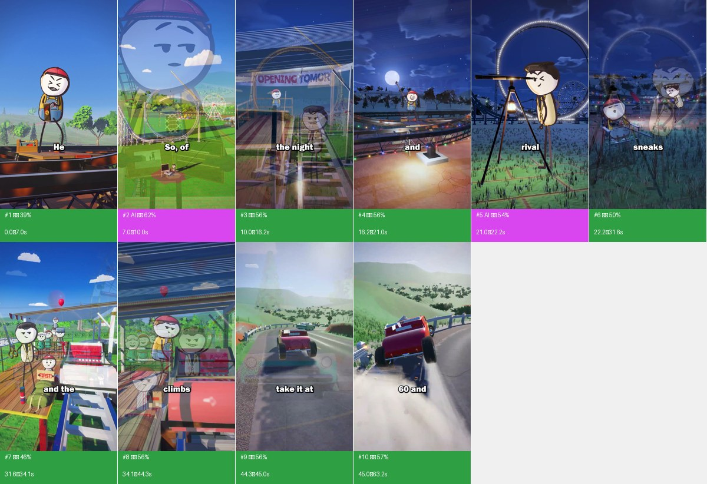
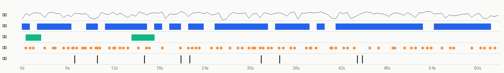

# Video breakdown: QlDPMzGmYac-bdeb1795a8623b99cb20b7bbb408c2be895-270.mp4

**Verdict**: Mixed production: live action 93% + AI-generated video 7%; overlays: styled text, text labels, subtitles (composited in code / an editor); real material used: live footage (59.0s); audio: voice + 78 sound effects; packaging: styled text ×8, text labels ×126, 77 sound effects land on text / sticker pops

- 63.167s · 1080×1920 · 30.0fps · 9:16; 10 shots, 6.32s average; transitions: cut×3, dissolve×6
- Confidence (duration-weighted) 53%; decided by: deterministic forensics only; No VLM; live action / AI / 3D are told apart from pixel statistics only, so confidence is limited. An agent that can see images: run rea-video review, look at each shot and merge with apply-review; otherwise configure a VLM (any OpenAI-compatible multimodal model, e.g. Gemini / GPT-4o / Doubao / Qwen-VL): set REA_VLM_BASE_URL, REA_VLM_API_KEY and REA_VLM_MODEL (several models comma-separated as fallbacks), then rerun with --vlm
- Remake: 2 AI video shots → 2 generation units, 2 Seedance 2.5 calls; live action 8 shots → 3 scenes, 5 camera setups (see “Remake plan”)
- ⚠️ 9 open questions, see “Open questions” first: Shot #1 (0.0–7.0s): live action at only 39% confidence, runner-up ai_video

<!--mix-->

| Base picture | Duration | Share |
|---|---|---|
| live action | 58.97s | 93% |
| AI-generated video | 4.2s | 7% |



## Content and structure

- No whole-video summary (needs the VLM or an agent watching the full video); subtitle text is under “Packaging layer”

## Cast, scenes and props

- No cast extracted (needs the VLM whole-video pass, or an agent filling top-level `cast` in `review_answers.json`); shots where the face detector saw a face (person or character): #5

## Sound



- loudness -16.8 dBFS, peak -2.1 dBFS; sound runs across cuts, laid in post as one bed (background changes 6.3dB at cuts vs 6.1dB within shots)
- Sources: Video type: live footage (location sound + music added in post) → voice: human recording; SFX: location sound

**Voice**

- 77% of the duration; pitch about 193.4Hz (gender unclear); sung
- Source: human recording (human_recording 73%, tts 20%, ai_video_native 7%)
  - 93% of the picture is live footage: the voice is most likely location sound or a human voice-over
- Remake: capsule-cinema DoubaoTTSTool / UniversalTTSTool (or a MiniMax cloned voice); use duration-controlled TTS when it must fit the original time window

**Music**

- No sustained music bed detected

**Sound effects** (78)

<details><summary>all 60 sound effects</summary>

| Time | Type | Description | On screen | Basis |
|---|---|---|---|---|
| 0.51s | ding | text label "roller" appears | text label "roller" appears | deterministic_anchored |
| 1.06s | whoosh | text label "loop" appears | text label "loop" appears | deterministic_anchored |
| 1.54s | ding | text label "out of" appears | text label "out of" appears | deterministic_anchored |
| 3.01s | ding | text label "filrst" appears | text label "filrst" appears | deterministic_anchored |
| 4.12s | whoosh | text label "to go" appears | text label "to go" appears | deterministic_anchored |
| 4.42s | ding | text label "psdn" appears | text label "psdn" appears | deterministic_anchored |
| 5.53s | whoosh | text label "it cost him" appears | text label "it cost him" appears | deterministic_anchored |
| 6.13s | pop | text label "everything." appears | text label "everything." appears | deterministic_anchored |
| 6.69s | whoosh | — | — | signal candidate (low confidence) |
| 6.82s | whoosh | text label "course," appears | text label "course," appears | deterministic_anchored |
| 7.27s | whoosh | — | text label "his" appears | signal candidate (low confidence) |
| 8.01s | ding | text label "TNIVS LOOP" appears | text label "TNIVS LOOP" appears | deterministic_anchored |
| 8.14s | whoosh | text label "bolt" appears | text label "bolt" appears | deterministic_anchored |
| 8.39s | whoosh | — | text label "LOOP" appears | signal candidate (low confidence) |
| 9.12s | ding | text label "But" appears | text label "But" appears | deterministic_anchored |
| 9.81s | whoosh | text label "before" appears | text label "before" appears | deterministic_anchored |
| 10.00s | pop | text label "OPENING TOMOR" appears | text label "OPENING TOMOR" appears | deterministic_anchored |
| 10.29s | whoosh | — | text label "opening," appears | signal candidate (low confidence) |
| 11.56s | pop | text label "dummy" appears | text label "dummy" appears | deterministic_anchored |
| 12.12s | pop | text label "back" appears | text label "OPENING TOMOR" appears | deterministic_anchored |
| 12.32s | whoosh | text label "OPENING TOMOR" appears | text label "OPENING TOMOR" appears | deterministic_anchored |
| 12.95s | whoosh | text label "a soda can." appears | text label "a soda can." appears | deterministic_anchored |
| 13.42s | whoosh | text label "But" appears | text label "But" appears | deterministic_anchored |
| 14.00s | whoosh | text label "he can't" appears | text label "he can't" appears | deterministic_anchored |
| 15.41s | ding | text label "and" appears | text label "and" appears | deterministic_anchored |
| 16.48s | ding | text label "the bottom" appears | text label "the bottom" appears | deterministic_anchored |
| 16.86s | pop | text label "into a" appears | text label "into a" appears | deterministic_anchored |
| 18.58s | ding | — | text label "curve." appears | signal candidate (low confidence) |
| 20.93s | whoosh | text label "rival" appears | text label "rival" appears | deterministic_anchored |
| 22.04s | ding | text label "sneaks" appears | text label "sneaks" appears | deterministic_anchored |
| 22.50s | whoosh | text label "in and" appears | text label "in and" appears | deterministic_anchored |
| 23.01s | whoosh | text label "cranks" appears | text label "cranks" appears | deterministic_anchored |
| 23.43s | whoosh | text label "the sides" appears | text label "the sides" appears | deterministic_anchored |
| 25.08s | whoosh | — | text label "is tall" appears | signal candidate (low confidence) |
| 25.82s | ding | text label "SO7" appears | text label "SO7" appears | deterministic_anchored |
| 26.32s | ding | text label "the first cart" appears | text label "the first cart" appears | deterministic_anchored |
| 27.53s | ding | text label "twig." appears | text label "twig." appears | deterministic_anchored |
| 28.54s | whoosh | styled text "OTTONCANDY" appears | styled text "OTTONCANDY" appears | deterministic_anchored |
| 29.13s | whoosh | text label "ANDY-" appears | text label "ANDY-" appears | deterministic_anchored |
| 29.98s | ding | text label "GRANDOPENING" appears | text label "GRANDOPENING" appears | deterministic_anchored |
| 30.48s | ding | text label "perfect" appears | text label "perfect" appears | deterministic_anchored |
| 30.75s | whoosh | text label "circle." appears | text label "circle." appears | deterministic_anchored |
| 31.48s | ding | styled text "FIRST!" appears | styled text "FIRST!" appears | deterministic_anchored |
| 31.92s | whoosh | text label "climbs" appears | text label "climbs" appears | deterministic_anchored |
| 32.57s | ding | text label "FIRST!·front" appears | text label "FIRST!·front" appears | deterministic_anchored |
| 33.02s | whoosh | — | text label "oto" appears | signal candidate (low confidence) |
| 33.99s | pop | text label "climbs" appears | text label "climbs" appears | deterministic_anchored |
| 34.58s | ding | text label "into his," appears | text label "into his," appears | deterministic_anchored |
| 35.57s | ding | text label "UPSTR" appears | text label "UPSTR" appears | deterministic_anchored |
| 36.03s | whoosh | styled text "SIDE-DOV" appears | styled text "SIDE-DOV" appears | deterministic_anchored |
| 37.62s | whoosh | text label "sees" appears | text label "sees" appears | deterministic_anchored |
| 38.09s | ding | — | text label "tall" appears | signal candidate (low confidence) |
| 38.23s | whoosh | — | text label "skinny" appears | signal candidate (low confidence) |
| 38.87s | whoosh | — | text label "loop" appears | signal candidate (low confidence) |
| 40.83s | whoosh | — | text label "see," appears | signal candidate (low confidence) |
| 41.01s | whoosh | text label "see," appears | text label "see," appears | deterministic_anchored |
| 41.47s | ding | — | text label "n" appears | signal candidate (low confidence) |
| 42.53s | ding | text label "hairpin" appears | text label "hairpin" appears | deterministic_anchored |
| 43.03s | whoosh | text label "at five," appears | text label "at five," appears | deterministic_anchored |
| 43.94s | whoosh | text label "take it at" appears | text label "take it at" appears | deterministic_anchored |

</details>

- Source: location sound (live_sync 65%, library_editor 24%, ai_native 12%)
  - The picture is mostly live footage: the ambience is most likely location sound
- Remake: Place by timestamp: capsule-cinema SoundEffectsTool / an SFX library, or synthesise procedurally like the plush recipe (pitched to the music key)

- Separated stems: `stems/original.wav` (original), `stems/vocals.wav` (dry voice; transient sound effects land here too), `stems/music.wav` (music + ambience)
<!--stems-->

## Camera, lighting and editing

- Framing: shot size medium close-up 76%, close-up 12%, medium shot 12%; subject is the in-focus region (no face; shot size is an estimate)
- Camera: moving camera (gimbal / handheld pan) 100%; typical move push-in
- Lighting: soft frontal light (flat light). Key light frontal (from the camera side; both sides of the subject about equally bright), from above (ceiling light / street lamp / high source); lighting ratio about 1.2:1 (0.3 stops); medium-soft; colour temperature neutral (about 5000K); subject and background differ in colour temperature: mixed sources (e.g. warm lamp + cool window light / screen); background clearly blurred (shallow depth of field / portrait mode)
- Grade: natural (close to the original colours); high saturation, normal contrast, normal blacks, overall cool
- Editing: 8.5 cuts per minute, 7.37s average live-action shot; 6 camera set-up(s) / location(s); 0 jump cut(s) and 0 punch-in(s) within the same set-up; inserts (screenshots / screen recordings / cards / stock) take 7%; 0% of cuts land in pauses of the speech
- Format: handheld product shots (unboxing / selling / POV) (face as subject 0%, objects / hands as subject 100%, handheld 100%)

**Shooting plan for the remake**

1. Format: handheld product shots
2. Framing: mostly medium close-up
3. Camera: moving camera (gimbal / handheld pan) 100%; typical move push-in
4. Lighting: soft frontal light (flat light) — a large source from the camera side, almost no shadow on the subject: facing a window, a ring light, or a big softbox behind the camera
5. Editing: 8.5 cuts per minute, 7.37s average live-action shot; 6 camera set-up(s) / location(s); 0 jump cut(s) and 0 punch-in(s) within the same set-up; inserts (screenshots / screen recordings / cards / stock) take 7%; 0% of cuts land in pauses of the speech

Gear:
- one large soft light straight above the desk / behind the camera (or two, symmetrical at 45°)
- white desk or white cards to bounce; shadows go lighter
- Note: subject and background differ in colour temperature: mixed sources (e.g. warm lamp + cool window light / screen)
- Note: background clearly blurred (shallow depth of field / portrait mode)

<details><summary>Per-item measurements and image readings (6)</summary>

| Aspect | Item | Verdict | Sources |
|---|---|---|---|
| Framing | shot size | medium close-up | measured |
| Camera | camera support | moving camera (gimbal / handheld pan) | measured |
| Lighting | soft / hard | medium-soft | measured |
| Lighting | colour temperature | neutral (about 5000K) | measured |
| Grade | colour grade | natural (close to the original colours) | measured |
| Format | video format | handheld product shots (unboxing / selling / POV) | measured |

</details>

- Note: lighting ratio, soft / hard, colour temperature and shot size are measured on the subject's pixels (the face when there is one, otherwise the in-focus region, which is an estimate); platform transcodes crush the shadows, so hardness and fill read conservative; camera angle, light source, catchlight and rim light follow the image readers. Where measurement and readers disagree, both are listed.

## Packaging layer (subtitles / styled text / stickers / sound-effect hits)

- styled text ×8 (large size, tilted, multi-colour / gradient, red fill, thick outline, brown fill, orange fill): "OTTONCANDY", "PENING", "IIIIN", "FIRST!", "FTDCTI", "NNER" …
- text label ×126 (2 of them follow an object): "bent", "roller", "loop", "out of", "shape.", "see," …
- SFX hits on: text label in ×73, styled text in ×4
- Exports: `packaging/overlays.ass`, `packaging/timeline.json` (SRT is the subtitle timeline; ASS carries colour, outline, position and entrance animation, swap in the original font; timeline.json is the full timeline)

<details><summary>text timeline (120 rows)</summary>

| Time | Kind | Text | Style | In / out | SFX |
|---|---|---|---|---|---|
| 0.00–0.20s | text label | bent | white text, black outline, line height 4.1% (about 78px) | hard out | — |
| 0.50–0.60s | text label | roller | white text, black outline, line height 3.7% (about 70px) | hard in / hard out | ding |
| 1.00–1.10s | text label | loop | white text, black outline, line height 4.3% (about 83px) | hard in / hard out | whoosh |
| 1.50–1.60s | text label | out of | white text, black outline, line height 3.8% (about 72px) | hard in / hard out | ding |
| 2.00–2.10s | text label | shape. | white text, black outline, line height 4.8% (about 92px) | hard in / hard out | — |
| 2.40–2.80s | text label | see, | white text, black outline, line height 4.4% (about 84px) | hard in / hard out | — |
| 3.00–3.10s | text label | filrst | white text, black outline, line height 4.4% (about 84px) | hard in / hard out | ding |
| 3.50–3.60s | text label | ever | white text, black outline, yellow box, line height 3.8% (about 72px) | hard in / hard out | — |
| 4.00–4.10s | text label | to go | white text, black outline, line height 5.1% (about 98px) | hard in / hard out | whoosh |
| 4.30–4.60s | text label | psdn | white text, black outline, line height 4.6% (about 89px) | hard in / hard out | ding |
| 5.00–5.10s | text label | and | white text, black outline, line height 4.3% (about 83px) | hard in / hard out | — |
| 5.50–5.70s | text label | it cost him | white text, black outline, line height 4.5% (about 85px) | hard in | whoosh |
| 6.00–6.60s | text label | everything. | white text, black outline, brown box, line height 4.6% (about 88px) | fade out | pop |
| 6.90–7.10s | text label | course, | white text, black outline, line height 4.5% (about 85px) | slide in / hard out | whoosh |
| 7.20–7.60s | text label | his | white text, black outline, line height 4.9% (about 94px) | hard out | whoosh |
| 8.00–9.60s | text label | TNIVS ⏎ LOOP | grey text, line height 1.6% (about 31px) | hard in / hard out | ding |
| 8.00–8.10s | text label | copies it | white text, black outline, line height 4.2% (about 81px) | hard in / hard out | — |
| 8.10–9.10s | text label | bolt | white text, black outline, line height 3.9% (about 74px) | hard out | whoosh |
| 8.50–9.10s | text label | LOOP | black text, grey outline, line height 1.6% (about 31px) | — | whoosh |
| 9.10–9.90s | text label | But | white text, black outline, line height 3.7% (about 70px) | hard out | ding |
| 9.90–10.20s | text label | before | white text, black outline, line height 3.9% (about 75px) | hard out | whoosh |
| 10.00–12.10s | text label · follows an object | OPENING TOMOR | brown text, purple outline, keywords highlighted in blue, line height 7.3% (about 140px) | hard in / hard out | pop |
| 10.30–10.60s | text label | opening, | white text, black outline, line height 3.8% (about 74px) | fade in / hard out | whoosh |
| 11.00–11.50s | text label | test | white text, black outline, red box, line height 3.6% (about 69px) | hard in | — |
| 11.50–11.70s | text label | dummy | white text, black outline, line height 4.4% (about 84px) | hard in / hard out | pop |
| 12.00–12.10s | text label | back | white text, black outline, purple box, line height 3.9% (about 75px) | hard in / hard out | — |
| 12.20–14.10s | text label · follows an object | OPENING TOMOR | blue text, purple outline, keywords highlighted in brown, line height 9.4% (about 181px) | fade out (bounces / changes colour midway) | pop, whoosh |
| 12.50–12.60s | text label | crushed | white text, black outline, line height 3.7% (about 70px) | hard in / hard out | — |
| 13.00–13.10s | text label | a soda can. | white text, line height 3.0% (about 59px) | hard in / hard out | whoosh |
| 13.50–13.60s | text label | But | white text, black outline, line height 4.0% (about 76px) | hard in / hard out | whoosh |
| 14.00–14.10s | text label | he can't | white text, black outline, line height 3.7% (about 70px) | hard in / hard out | whoosh |
| 14.50–16.10s | text label | DOPENING | brown text, keywords highlighted in purple, line height 10.8% (about 207px) | hard in / hard out | — |
| 14.50–14.60s | text label | the opening | white text, black outline, line height 4.5% (about 87px) | hard in / hard out | — |
| 15.00–15.10s | text label | Sohe | white text, black outline, line height 4.3% (about 83px) | hard in / hard out | — |
| 15.40–16.20s | text label | and | white text, black outline, blue box, line height 3.5% (about 68px) | type-on / hard out | ding |
| 16.40–16.70s | text label | the bottom | white text, black outline, line height 3.8% (about 74px) | hard in | ding |
| 16.90–17.20s | text label | into a | black text, white outline, orange box, keywords highlighted in orange, line height 5.1% (about 98px) | hard in / hard out | pop |
| 17.50–18.00s | text label | Iong, | white text, black outline, line height 5.4% (about 103px) | hard in | — |
| 18.00–18.10s | text label | lazy | white text, black outline, line height 4.9% (about 94px) | hard in / hard out | — |
| 18.50–18.60s | text label | curve. | white text, black outline, line height 3.6% (about 69px) | hard in / hard out | ding |
| 19.00–19.10s | text label | he know | white text, black outline, line height 4.1% (about 78px) | hard in / hard out | — |
| 19.50–19.60s | text label | 带 | red text, white outline, line height 2.4% (about 46px) | hard in / hard out | — |
| 19.50–19.60s | text label | doing? | white text, black outline, blue box, line height 4.8% (about 92px) | hard in / hard out | — |
| 20.00–20.90s | text label | Not really. | white text, black outline, line height 4.4% (about 84px) | fade in / hard out | — |
| 21.00–21.10s | text label | rival | white text, black outline, line height 4.2% (about 81px) | hard in / hard out | whoosh |
| 21.50–21.60s | text label | laughs, | white text, black outline, line height 4.8% (about 92px) | hard in / hard out | — |
| 22.00–22.10s | text label | sneaks | white text, black outline, line height 3.7% (about 70px) | hard in / hard out | ding |
| 22.50–22.60s | text label | in and | white text, black outline, line height 3.7% (about 70px) | hard in / hard out | whoosh |
| 23.00–23.10s | text label | cranks | white text, black outline, line height 3.7% (about 70px) | hard in / hard out | whoosh |
| 23.50–23.60s | text label | the sides | white text, black outline, line height 3.8% (about 74px) | hard in / hard out | whoosh |
| 24.00–24.10s | text label | cuntil | white text, black outline, line height 4.7% (about 90px) | hard in / hard out | — |
| 24.50–24.60s | text label | loop | white text, black outline, line height 4.9% (about 94px) | hard in / hard out | — |
| 25.00–25.20s | text label | is tall | white text, black outline, line height 4.2% (about 81px) | hard in / hard out | whoosh |
| 25.30–25.80s | text label | and skinny. | white text, black outline, line height 4.8% (about 92px) | hard in / hard out | — |
| 25.90–26.10s | text label | SO7 | white text, black outline, line height 5.2% (about 99px) | hard in / hard out | ding |
| 26.40–26.70s | text label | the first cart | white text, black outline, line height 3.8% (about 74px) | hard in / hard out | ding |
| 27.00–27.10s | text label | snap | white text, black outline, line height 4.2% (about 81px) | hard in / hard out | — |
| 27.50–27.60s | text label | twig. | white text, black outline, line height 5.7% (about 109px) | hard in / hard out | ding |
| 28.00–28.20s | text label | The next | white text, black outline, line height 4.3% (about 83px) | hard in / hard out | — |
| 28.50–28.60s | styled text | OTTONCANDY | white text, red outline, keywords highlighted in orange, line height 6.2% (about 120px) | hard in / hard out | whoosh |
| 28.50–29.60s | styled text | PENING | red text, white outline, grey box, bold, line height 1.6% (about 30px) | hard in / fade out (bounces / changes colour midway) | — |
| 28.50–28.60s | text label | morning, | white text, black outline, line height 4.7% (about 90px) | hard in / hard out | — |
| 28.90–29.10s | text label | town | white text, black outline, bold, line height 3.6% (about 69px) | hard in / hard out | — |
| 29.00–29.10s | text label | ANDY- | white text, red outline, line height 3.8% (about 74px) | hard in / hard out | whoosh |
| 29.50–29.60s | text label | lines | white text, black outline, line height 4.0% (about 76px) | hard in / hard out | — |
| 30.00–31.40s | text label | GRANDOPENING | red text, orange outline, bold, line height 2.1% (about 41px) | hard in / fade out | ding |
| 30.00–30.10s | text label | rivals | white text, black outline, line height 3.8% (about 72px) | hard in / hard out | — |
| 30.00–30.10s | styled text | IIIIN | brown text, brown outline, line height 1.9% (about 37px) | hard in / hard out | — |
| 30.50–30.60s | text label | perfect | white text, black outline, line height 4.5% (about 87px) | hard in / hard out | ding |
| 30.70–31.20s | text label | circle. | white text, black outline, line height 3.7% (about 70px) | hard in / hard out | whoosh |
| 31.30–31.60s | text label | and the | white text, black outline, yellow box, bold, line height 3.7% (about 70px) | fade in / hard out | — |
| 31.50–32.20s | styled text | FIRST! | red text, keywords highlighted in brown, line height 3.5% (about 67px) | fade in / fade out | ding |
| 31.80–32.20s | text label | climbs | white text, black outline, line height 4.3% (about 83px) | hard in / hard out | whoosh |
| 32.50–32.60s | text label | FIRST!·front | white text, black outline, keywords highlighted in red, line height 4.7% (about 90px) | hard in / hard out | ding |
| 33.00–33.10s | text label | oto | white text, keywords highlighted in grey, line height 1.1% (about 21px) | hard in / hard out | whoosh |
| 33.00–33.20s | text label | toshow | white text, black outline, line height 4.1% (about 79px) | hard in / fade out | — |
| 33.00–33.10s | text label | FIRST! | red text, line height 4.5% (about 85px) | hard in / hard out | — |
| 33.30–33.90s | text label | The | white text, black outline, line height 4.8% (about 92px) | hard in | — |
| 33.50–33.60s | styled text | FTDCTI | red text, keywords highlighted in orange, bold, line height 2.6% (about 50px) | hard in / hard out | — |
| 33.90–34.10s | text label | climbs | white text, black outline, line height 3.7% (about 70px) | hard out | pop |
| 34.50–34.60s | text label | into his, | white text, black outline, line height 5.1% (about 98px) | hard in / hard out | ding |
| 34.90–35.10s | text label | as his | white text, black outline, line height 4.4% (about 84px) | hard in / hard out | — |
| 35.50–35.60s | text label | UPSTR | grey text, keywords highlighted in white, line height 6.7% (about 129px) | hard in / hard out | ding |
| 35.50–35.60s | text label | cart | white text, black outline, blue box, line height 4.5% (about 85px) | hard in / hard out | — |
| 35.50–35.60s | styled text | NNER | white text, red outline, line height 13.1% (about 252px) | hard in / hard out | — |
| 36.00–36.10s | styled text | SIDE-DOV | white text, red outline, line height 21.2% (about 408px) | hard in / hard out | whoosh |
| 36.00–37.10s | text label | over | white text, black outline, line height 4.8% (about 93px) | hard in / hard out (bounces / changes colour midway) | — |
| 37.50–37.60s | text label | sees | white text, black outline, line height 3.1% (about 60px) | hard in / hard out | whoosh |
| 38.00–38.10s | text label | tall | white text, black outline, line height 3.9% (about 75px) | hard in / hard out | ding |
| 38.40–38.60s | text label | skinny | white text, black outline, line height 4.5% (about 85px) | hard in / hard out | whoosh |
| 38.70–39.20s | text label | loop | white text, black outline, black box, line height 4.3% (about 83px) | fade in / fade out | whoosh |
| 39.50–39.60s | text label | ahead. | white text, black outline, line height 3.4% (about 65px) | hard in / hard out | — |
| 40.00–40.10s | text label | it's | white text, black outline, line height 4.5% (about 87px) | hard in / hard out | — |
| 40.50–40.70s | text label | late. | white text, black outline, line height 3.8% (about 72px) | hard in / hard out | — |
| 41.00–41.10s | text label | see, | white text, black outline, line height 3.9% (about 75px) | hard in / hard out | whoosh, whoosh |
| 41.40–41.80s | text label | a car | white text, black outline, line height 3.8% (about 74px) | hard in / hard out | — |
| 41.50–41.60s | text label | n | yellow text, line height 3.1% (about 60px) | hard in / hard out | ding |
| 42.00–42.30s | text label | creep | white text, black outline, line height 4.5% (about 87px) | hard in / hard out | — |
| 42.50–42.60s | text label | hairpin | white text, black outline, line height 5.0% (about 96px) | hard in / hard out | ding |
| 43.00–43.80s | text label | at five, | white text, black outline, line height 5.0% (about 96px) | fade out | whoosh |
| 44.00–44.20s | text label | take it at | white text, black outline, line height 3.8% (about 74px) | hard in / hard out | whoosh |
| 44.40–45.60s | text label | flips. | white text, black outline, line height 5.1% (about 98px) | hard in / hard out (bounces / changes colour midway) | — |
| 46.00–46.10s | text label | Acart | white text, black outline, line height 4.5% (about 87px) | hard in / hard out | whoosh |
| 46.50–46.60s | text label | fastest | white text, black outline, line height 4.6% (about 89px) | hard in / hard out | — |
| 46.60–47.10s | text label | bottom | white text, black outline, line height 4.5% (about 87px) | hard in / hard out | — |
| 47.20–47.60s | text label | a loop | white text, black outline, line height 5.4% (about 103px) | hard in / hard out | pop |
| 47.90–48.10s | text label | anda | white text, black outline, line height 4.5% (about 85px) | hard out | — |
| 48.50–48.60s | text label | circle | white text, black outline, line height 4.5% (about 87px) | hard in / hard out | — |
| 49.00–49.20s | text label | puts | white text, black outline, line height 5.2% (about 99px) | hard in / hard out | ding |
| 49.40–49.70s | text label | a hairpin | white text, black outline, line height 4.4% (about 84px) | hard in / hard out | whoosh |
| 50.00–50.10s | text label | there, | white text, black outline, line height 5.0% (about 96px) | hard in / hard out | — |
| 50.50–50.60s | text label | which is | white text, black outline, line height 4.1% (about 79px) | hard in / hard out | whoosh |
| 50.90–51.40s | text label | crushed | white text, black outline, line height 4.6% (about 89px) | — | — |
| 51.40–51.80s | text label | the dummy. | white text, black outline, line height 4.8% (about 92px) | hard in / fade out | ding |
| 51.90–52.10s | text label | his hammer | white text, black outline, line height 4.4% (about 84px) | hard out | ding |
| 52.40–52.60s | text label | made | white text, black outline, keywords highlighted in orange, line height 4.2% (about 81px) | fade in / hard out | — |
| 53.00–53.10s | text label | bottom | white text, black outline, line height 4.0% (about 76px) | hard in / hard out | whoosh |
| 53.50–53.60s | text label | gentle | white text, black outline, brown box, line height 5.0% (about 96px) | hard in / hard out | whoosh |
| 54.00–54.40s | text label | rival's | white text, black outline, line height 4.8% (about 93px) | hard in | pop |
| 54.40–54.70s | text label | squeeze | white text, black outline, line height 3.6% (about 69px) | hard out | — |

</details>

Remake: burn subtitles and styled text in with `packaging/overlays.ass` (ffmpeg -vf ass=overlays.ass), or rebuild them from timeline.json in CapCut / Remotion; stickers and GIFs need matching assets (meme / GIF libraries), crops are under packaging/.

## Remake plan

**2 AI video shots → 2 generation units, 2 Seedance 2.5 calls; live action 8 shots → 3 scenes, 5 camera setups**

- The default engine Seedance 2.0（含 Mini / Fast） cannot generate several shots in one call; with it you would generate shot by shot, 2 times. This plan is for Seedance 2.5 (≤30s per call, multi-shot in one call), 2 calls in total
- Grouping: AI shots in the same scene joined by hard cuts are generated in one call; ≤30s per call; consecutive hard cuts inside a unit preferably ≤8s, at most 10s; split at dissolves / fades and scene changes
- Audio: the model can generate action sound effects and ambience along with the picture; voice-over is better done as separate TTS and mixed in, so copy and timing stay editable

### Generation units

| Unit | Shots | Time | Duration | Mode | Continuity |
|---|---|---|---|---|---|
| G1 | #2 | 7.0–10.0s | 3.0s | single shot | first frame: generate an image matching the composition of source shot 2's first frame (shots/shot_002_first.jpg) |
| G2 | #5 | 21.0–22.2s | 1.2s | single shot | first frame: generate an image matching the composition of source shot 5's first frame (shots/shot_005_first.jpg) |

**G1 · AI-generated video · shots #2 · 3.0s**

- References: `@图片1` character reference images (one frontal face + one half-body per character) so the look stays consistent across shots; `@视频1` source clip 7.0–10.0s: reference for action, camera movement and cutting rhythm (reference only, do not copy the picture)
- Generate 4s and trim to 3.0s (very short shots are unstable when generated on their own)
- Shots #2 have no prompt

```text
Vertical 9:16; coloured ambient light (RGB lights / neon), soft light (almost no lit / shadow edge), cool (daylight / cool-white LED), background clearly blurred (shallow depth of field / portrait mode). Characters follow @图片1. Follow the action, camera movement and cutting rhythm of @视频1.
(prompt missing: run --vlm or have the agent write one from the frames)
```

**G2 · AI-generated video · shots #5 · 1.2s**

- References: `@图片1` character reference images (one frontal face + one half-body per character) so the look stays consistent across shots; `@视频1` source clip 21.0–22.2s: reference for action, camera movement and cutting rhythm (reference only, do not copy the picture)
- Generate 4s and trim to 1.2s (very short shots are unstable when generated on their own)
- Shots #5 have no prompt

```text
Vertical 9:16; coloured ambient light (RGB lights / neon), soft light (almost no lit / shadow edge), cool (daylight / cool-white LED), background clearly blurred (shallow depth of field / portrait mode). Characters follow @图片1. Follow the action, camera movement and cutting rhythm of @视频1.
(prompt missing: run --vlm or have the agent write one from the frames)
```

### Shooting scenes

Shoot every shot of one scene before moving to the next; within a scene, shoot the wider sizes first and the close-ups last so the lighting is set only once. Leave about 1s of handle at both ends of every take.

**S1**: shots #1 (6.97s on screen)
- Lighting: soft frontal light (flat light), frontal (from the camera side; both sides of the subject about equally bright), about 1.1:1 (0.2 stops), cool (daylight / cool-white LED)
- Setup close-up · moving camera (gimbal / handheld pan) · push-in: shots #1, 6.97s on screen, shoot about 9.0s

**S2**: shots #3, #4, #6, #7, #8 (33.13s on screen)
- Lighting: soft frontal light (flat light), frontal (from the camera side; both sides of the subject about equally bright), about 1.2:1 (0.3 stops), cool (daylight / cool-white LED)
- Setup medium shot · moving camera (gimbal / handheld pan) · push-in: shots #3, 6.2s on screen, shoot about 8.2s
- Setup medium close-up · moving camera (gimbal / handheld pan) · push-in: shots #4, #6, #7, #8, 26.93s on screen, shoot about 34.9s

**S3**: shots #9, #10 (18.87s on screen)
- Lighting: soft frontal light (flat light), frontal (from the camera side; both sides of the subject about equally bright), about 1.1:1 (0.1 stops), cool (daylight / cool-white LED)
- Setup medium shot · moving camera (gimbal / handheld pan) · push-in: shots #9, 0.7s on screen, shoot about 2.7s
- Setup medium close-up · moving camera (gimbal / handheld pan) · push-in: shots #10, 18.17s on screen, shoot about 20.2s

### Real material in the picture (the original files are needed)

8 shots, 58.97s (93%) contain real material (screen recordings, screenshots, photos, embedded video); a model cannot stand in for them:

- Shot #1 (00:00.000): live footage, whole frame
- Shot #3 (00:09.967): live footage, whole frame
- Shot #4 (00:16.167): live footage, whole frame
- Shot #6 (00:22.200): live footage, whole frame
- Shot #7 (00:31.633): live footage, whole frame
- Shot #8 (00:34.067): live footage, whole frame
- Shot #9 (00:44.300): live footage, whole frame
- Shot #10 (00:45.000): live footage, whole frame

## Shot list

| # | Time | Length | Base picture | Material | Overlays | Camera | Picture | Remake |
|---|---|---|---|---|---|---|---|---|
| 1 | 00:00.000 | 6.97s | live action 39% | the user's real material: live footage | subtitle | smooth move | — | reshoot · S1 |
| 2 | 00:06.967 | 3.00s | AI-generated video 62% | AI-generated | subtitle, text | smooth move | — | AI generation (first / last frame) · G1 |
| 3 | 00:09.967 | 6.20s | live action 56% | the user's real material: live footage | subtitle | smooth move | — | reshoot · S2 |
| 4 | 00:16.167 | 4.83s | live action 56% | the user's real material: live footage | subtitle | smooth move | — | reshoot · S2 |
| 5 | 00:21.000 | 1.20s | AI-generated video 54% | AI-generated | subtitle | smooth move | — | AI generation (first / last frame) · G2 |
| 6 | 00:22.200 | 9.43s | live action 50% | the user's real material: live footage | subtitle, styled text | smooth move | — | reshoot · S2 |
| 7 | 00:31.633 | 2.43s | live action 46% | the user's real material: live footage | subtitle, text, styled text | smooth move | — | reshoot · S2 |
| 8 | 00:34.067 | 10.23s | live action 56% | the user's real material: live footage | subtitle, styled text | smooth move | — | reshoot · S2 |
| 9 | 00:44.300 | 0.70s | live action 56% | the user's real material: live footage | subtitle | smooth move | — | reshoot · S3 |
| 10 | 00:45.000 | 18.17s | live action 57% | the user's real material: live footage | subtitle, styled text | smooth move | — | reshoot · S3 |

## Open questions

- Shot #1 (0.0–7.0s): live action at only 39% confidence, runner-up ai_video
- Shot #3 (10.0–16.2s): live action at only 56% confidence, runner-up ai_video
- Shot #4 (16.2–21.0s): live action at only 56% confidence, runner-up ai_video
- Shot #5 (21.0–22.2s): AI or live action, to confirm: only a sharpness rhythm, no duplicate frames (re-encodes leave it too) and no AIGC label, needs an image reader
- Shot #6 (22.2–31.6s): live action at only 50% confidence, runner-up ai_video
- Shot #7 (31.6–34.1s): live action at only 46% confidence, runner-up ai_video
- Shot #8 (34.1–44.3s): live action at only 56% confidence, runner-up ai_video
- Shot #9 (44.3–45.0s): live action at only 56% confidence, runner-up ai_video
- Shot #10 (45.0–63.2s): live action at only 57% confidence, runner-up ai_video

## Appendix

### Shot by shot

Evidence, probabilities, text tracks and prompts per shot. Folded by default.

<details><summary>#1 00:00.000–00:06.967 · live action + code / editor overlays (subtitles); brings in real material (live footage)</summary>


- Probabilities: live action 39%, AI-generated video 26%, 3D render 23%（deterministic）
- Material: the user's real material: live footage
- Photographic texture: noise σ=0.16, 352 colours, 20% flat blocks
- The whole file is native 30fps and photographic shots carry no 24fps-source duplicate frames (98% of the duration): typical of straight-from-phone footage, generators mostly output 24fps
- Temporal noise 0.94, 43% of pixels unchanged frame to frame: sensor noise is present, consistent with live action
- Camera / lighting: close-up; moving camera (gimbal / handheld pan); soft frontal light (flat light); key light frontal (from the camera side; both sides of the subject about equally bright); lighting ratio about 1.1:1 (0.2 stops); soft light (almost no lit / shadow edge)
- Text track (subtitle/bottom): He / You / upside / So, of
- Remake: Source is live action: reshoot per the shooting plan (shot size / camera setup / lighting); only fall back to AI image-to-video (first frame as reference) when a shoot is not possible; real material the user must supply: live footage (whole frame)

</details>

<details><summary>#2 00:06.967–00:09.967 · AI-generated video + code / editor overlays (subtitles, text labels)</summary>


- Probabilities: AI-generated video 62%, 3D render 21%, code / template render 8%（deterministic）
- Material: AI-generated
- Photographic texture: noise σ=0.15, 364 colours, 21% flat blocks
- Camera / lighting: medium close-up; moving camera (gimbal / handheld pan); coloured ambient light (RGB lights / neon); key light frontal (from the camera side; both sides of the subject about equally bright); lighting ratio about 1.2:1 (0.2 stops); soft light (almost no lit / shadow edge)
- Text track (subtitle/bottom): So, of / rlval / for / the night
- Text track (subtitle/middle): HNV'S / LOOP / TNIVS / TANNG
- Text track (text/middle): OPENING TO
- Remake: Source is AI-generated: use the shot's first and last frames for first/last-frame generation to closely match composition and motion; to change the subject, edit the first frame with an image model first

</details>

<details><summary>#3 00:09.967–00:16.167 · live action + code / editor overlays (subtitles); brings in real material (live footage)</summary>


- Probabilities: live action 56%, AI-generated video 22%, 3D render 12%（deterministic）
- Text on objects in the scene (not subtitles): OPENING TOMOR, OPENING TOM, PENTNG
- Material: the user's real material: live footage
- Photographic texture: noise σ=0.47, 223 colours, 7% flat blocks
- The whole file is native 30fps and photographic shots carry no 24fps-source duplicate frames (98% of the duration): typical of straight-from-phone footage, generators mostly output 24fps
- Temporal noise 1.50, 19% of pixels unchanged frame to frame: sensor noise is present, consistent with live action
- Camera / lighting: medium shot; moving camera (gimbal / handheld pan); soft frontal light (flat light); key light frontal (from the camera side; both sides of the subject about equally bright); lighting ratio about 1.2:1 (0.3 stops); soft light (wide lit-to-shadow ramp)
- Text track (subtitle/bottom): the night / back / he can't / hammer
- Text track (subtitle/middle): OPENING TOMOR / OPENING TOM / PENTNG
- Remake: Source is live action: reshoot per the shooting plan (shot size / camera setup / lighting); only fall back to AI image-to-video (first frame as reference) when a shoot is not possible; real material the user must supply: live footage (whole frame)

</details>

<details><summary>#4 00:16.167–00:21.000 · live action + code / editor overlays (subtitles); brings in real material (live footage)</summary>


- Probabilities: live action 56%, AI-generated video 26%, 3D render 8%（deterministic）
- Material: the user's real material: live footage
- Photographic texture: noise σ=0.24, 189 colours, 11% flat blocks
- The whole file is native 30fps and photographic shots carry no 24fps-source duplicate frames (98% of the duration): typical of straight-from-phone footage, generators mostly output 24fps
- Temporal noise 1.35, 30% of pixels unchanged frame to frame: sensor noise is present, consistent with live action
- Camera / lighting: medium close-up; moving camera (gimbal / handheld pan); three-quarter key + fill (standard set-up); key light frame left, three-quarter front; lighting ratio about 1.4:1 (0.5 stops); medium-soft
- Text track (subtitle/bottom): and / long, / he know / His
- Remake: Source is live action: reshoot per the shooting plan (shot size / camera setup / lighting); only fall back to AI image-to-video (first frame as reference) when a shoot is not possible; real material the user must supply: live footage (whole frame)

</details>

<details><summary>#5 00:21.000–00:22.200 · AI-generated video + code / editor overlays (subtitles)</summary>


- Probabilities: AI-generated video 54%, live action 22%, 3D render 13%（deterministic）
- ⚠️ To confirm: AI or live action, to confirm: only a sharpness rhythm, no duplicate frames (re-encodes leave it too) and no AIGC label, needs an image reader
- Material: AI-generated
- Photographic texture: noise σ=0.40, 224 colours, 14% flat blocks
- Per-frame sharpness oscillates periodically (period 2 frames, correlation 0.62) with no duplicate frames: frame interpolation / rate conversion, or just the rhythm of a re-encode (transcodes whose platform tags were stripped show it too); not enough on its own to call AI
- Camera / lighting: medium close-up; moving camera (gimbal / handheld pan); soft frontal light (flat light); key light frontal (from the camera side; both sides of the subject about equally bright); lighting ratio about 1.1:1 (0.2 stops); soft light (almost no lit / shadow edge)
- Text track (subtitle/bottom): rival / laughs, / then
- Remake: Source is AI-generated: use the shot's first and last frames for first/last-frame generation to closely match composition and motion; to change the subject, edit the first frame with an image model first

</details>

<details><summary>#6 00:22.200–00:31.633 · live action + code / editor overlays (subtitles, styled text); brings in real material (live footage)</summary>


- Probabilities: live action 50%, AI-generated video 25%, 3D render 13%（deterministic）
- Material: the user's real material: live footage
- Photographic texture: noise σ=0.25, 159 colours, 15% flat blocks
- The whole file is native 30fps and photographic shots carry no 24fps-source duplicate frames (98% of the duration): typical of straight-from-phone footage, generators mostly output 24fps
- Temporal noise 1.17, 33% of pixels unchanged frame to frame: sensor noise is present, consistent with live action
- Camera / lighting: medium close-up; moving camera (gimbal / handheld pan); soft frontal light (flat light); key light frontal (from the camera side; both sides of the subject about equally bright); lighting ratio about 1.3:1 (0.4 stops); medium-soft
- Text track (subtitle/bottom): sneaks / is tall / The next / circle
- Text track (text/middle): GRAND OPENING
- Remake: Source is live action: reshoot per the shooting plan (shot size / camera setup / lighting); only fall back to AI image-to-video (first frame as reference) when a shoot is not possible; real material the user must supply: live footage (whole frame)

</details>

<details><summary>#7 00:31.633–00:34.067 · live action + code / editor overlays (subtitles, text labels, styled text); brings in real material (live footage)</summary>


- Probabilities: live action 46%, AI-generated video 33%, 3D render 11%（deterministic）
- Material: the user's real material: live footage
- Photographic texture: noise σ=0.23, 523 colours, 13% flat blocks
- The whole file is native 30fps and photographic shots carry no 24fps-source duplicate frames (98% of the duration): typical of straight-from-phone footage, generators mostly output 24fps
- Camera / lighting: medium close-up; moving camera (gimbal / handheld pan); soft frontal light (flat light); key light frontal (from the camera side; both sides of the subject about equally bright); lighting ratio about 1.3:1 (0.3 stops); hard light (sharp shadow edge)
- Text track (subtitle/bottom): and the / climbs / to show / owner
- Text track (text/bottom): FIRST!
- Text track (text/middle): FIRST!
- Text track (text/middle): oto
- Remake: Source is live action: reshoot per the shooting plan (shot size / camera setup / lighting); only fall back to AI image-to-video (first frame as reference) when a shoot is not possible; real material the user must supply: live footage (whole frame)

</details>

<details><summary>#8 00:34.067–00:44.300 · live action + code / editor overlays (subtitles, styled text); brings in real material (live footage)</summary>


- Probabilities: live action 56%, AI-generated video 25%, 3D render 9%（deterministic）
- Material: the user's real material: live footage
- Photographic texture: noise σ=0.22, 247 colours, 10% flat blocks
- The whole file is native 30fps and photographic shots carry no 24fps-source duplicate frames (98% of the duration): typical of straight-from-phone footage, generators mostly output 24fps
- Temporal noise 1.60, 21% of pixels unchanged frame to frame: sensor noise is present, consistent with live action
- Camera / lighting: medium close-up; moving camera (gimbal / handheld pan); three-quarter key + fill (standard set-up); key light frame right, three-quarter front; lighting ratio about 1.5:1 (0.6 stops); soft light (wide lit-to-shadow ramp)
- Text track (subtitle/bottom): climbs / he finally / late. / take it at
- Remake: Source is live action: reshoot per the shooting plan (shot size / camera setup / lighting); only fall back to AI image-to-video (first frame as reference) when a shoot is not possible; real material the user must supply: live footage (whole frame)

</details>

<details><summary>#9 00:44.300–00:45.000 · live action + code / editor overlays (subtitles); brings in real material (live footage)</summary>


- Probabilities: live action 56%, AI-generated video 27%, 3D render 7%（deterministic）
- Material: the user's real material: live footage
- Photographic texture: noise σ=0.13, 148 colours, 10% flat blocks
- The whole file is native 30fps and photographic shots carry no 24fps-source duplicate frames (98% of the duration): typical of straight-from-phone footage, generators mostly output 24fps
- Temporal noise 1.27, 31% of pixels unchanged frame to frame: sensor noise is present, consistent with live action
- Camera / lighting: medium shot; moving camera (gimbal / handheld pan); soft frontal light (flat light); key light frontal (from the camera side; both sides of the subject about equally bright); lighting ratio about 1.1:1 (0.1 stops); soft light (almost no lit / shadow edge)
- Text track (subtitle/bottom): take it at / 60 and
- Remake: Source is live action: reshoot per the shooting plan (shot size / camera setup / lighting); only fall back to AI image-to-video (first frame as reference) when a shoot is not possible; real material the user must supply: live footage (whole frame)

</details>

<details><summary>#10 00:45.000–01:03.167 · live action + code / editor overlays (subtitles, styled text); brings in real material (live footage)</summary>


- Probabilities: live action 57%, AI-generated video 27%, 3D render 7%（deterministic）
- Material: the user's real material: live footage
- Photographic texture: noise σ=0.19, 261 colours, 10% flat blocks
- The whole file is native 30fps and photographic shots carry no 24fps-source duplicate frames (98% of the duration): typical of straight-from-phone footage, generators mostly output 24fps
- Temporal noise 1.32, 28% of pixels unchanged frame to frame: sensor noise is present, consistent with live action
- Camera / lighting: medium close-up; moving camera (gimbal / handheld pan); soft frontal light (flat light); key light frontal (from the camera side; both sides of the subject about equally bright); lighting ratio about 1.0:1 (0.1 stops); soft light (almost no lit / shadow edge)
- Text track (subtitle/bottom): 60 and / crushed / crawling. / circle.
- Text track (text/middle): UPSIDE-DOWNER
- Remake: Source is live action: reshoot per the shooting plan (shot size / camera setup / lighting); only fall back to AI image-to-video (first frame as reference) when a shoot is not possible; real material the user must supply: live footage (whole frame)

</details>

### Metadata clues

- Encoder: `Lavf59.27.100`

### Notes

- Deterministic forensics is reliable on motion, whole-frame pan/zoom, rendered texture and 24→30 fps conversion; telling live action from AI from 3D relies on the VLM and human review.
- Platform transcoding usually strips metadata; missing metadata proves nothing.
- The full data is in `breakdown.json`; agents read the compact view with `rea-video summary`.
