> IMPORTANT: automatic live-action/SFX conclusions remain disputed. Read ../ANALYSIS-TH.md for the visual review, limits and production standard.

# Video breakdown: QlDPMzGmYac-bdeb1795a8623b99cb20b7bbb408c2be895-270.mp4

**Verdict**: Mixed production: live action 82% + 3D render 16% + AI-generated video 2%; overlays: animated sticker / GIF, text labels, static sticker, subtitles (composited in code / an editor); real material used: live footage (52.0s); audio: voice + 78 sound effects; packaging: 117 subtitle lines, stickers / GIFs ×3, 74 sound effects land on text / sticker pops

- 63.167s · 1080×1920 · 30.0fps · 9:16; 10 shots, 6.32s average; transitions: cut×3, dissolve×6
- Confidence (duration-weighted) 58%; decided by: deterministic forensics + agent image review; Codex-visual-review reviewed 10/10 shots by eye; merged into the verdict
- Remake: 2 3D render shots + 1 AI video shot → 3 generation units, 3 Seedance 2.5 calls; live action 7 shots → 2 scenes, 2 camera setups (see “Remake plan”)
- ⚠️ 8 open questions, see “Open questions” first: Shot #3 (10.0–16.2s): Tools say live action, the image review says 3D render; on…

<!--mix-->

| Base picture | Duration | Share |
|---|---|---|
| live action | 52.0s | 82% |
| 3D render | 9.97s | 16% |
| AI-generated video | 1.2s | 2% |

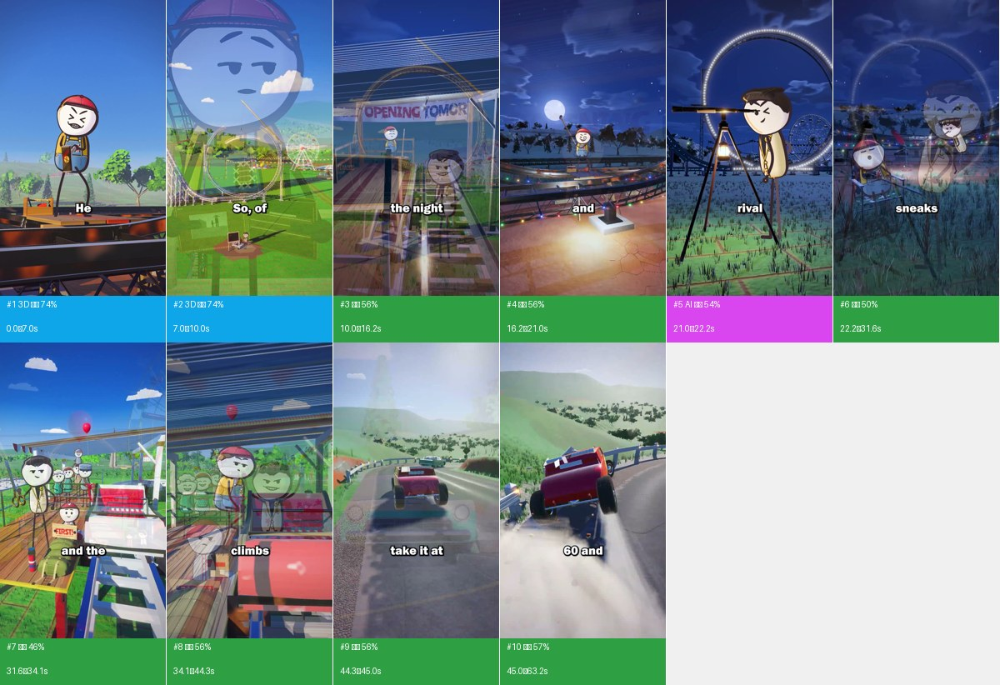

## Content and structure

- No whole-video summary (needs the VLM or an agent watching the full video); subtitle text is under “Packaging layer”

## Cast, scenes and props

For the remake, give every character one reference image (`@image`) used across all generation units and copy the look below into the first-frame prompts, so the character stays the same from shot to shot.

| Id | Name | Kind | Look | Role | Voice | Shots |
|---|---|---|---|---|---|---|
| A | Worker/ride owner | other | Red stitched cap, yellow shirt, blue patched overalls, round pale face with thick dark outline, dot eyes and expressive brows/mouth, thin dark limbs; small costume patches/buttons/stitches matter at close range. | Builds and adjusts ride, reacts to failed test, boards modified ride, relief/pay | Narration source unverified; no character voice identification claimed. | #1, #3, #4, #6, #8, #10 |
| B | Rival | other | Dark swept hair, cream waistcoat/jacket, tie/round lapel detail, thin dark limbs, smug brows and broad laughing mouth. | Copies ride, observes through telescope, sabotages shape, boards rival ride. | Unverified | #2, #5, #6, #7 |
| C | Visitors and queue | other | Distinct adult/child heights, patterned clothes, hats/glasses; child with red balloon; crowd gestures support opening. | Scale, life and stakes without distracting from focal action. | Unverified | #6, #7 |

**Scenes**

| Scene | Where | When | Set / light | Shots |
|---|---|---|---|---|
| S1 | Owner park construction loop and scaffold | Day / night / next day | Stable dark steel rail trusses, construction tools, grassy hills and trees; practical light string at night. | #1, #3, #4, #6, #8, #10 |
| S2 | Rival white circular-loop park and opening queue | Day / night / next morning | White track, crane/blueprint, wheel, bunting, booths, red carpet and wooden station. | #2, #5, #6, #7, #10 |
| S3 | Road hairpin analogy | Day | Banked/tight asphalt hairpin, guardrails/posts, hill, foliage and cars; distinct explanatory insert. | #8, #9, #10 |

**Props / products / logos**

- Sledgehammer and reshaping rail (shots #1, #3, #4, #10): Physical swing/contact, sparks and visible changed curve.
- Wallet (shots #1): Open hinged wallet with seams and a tiny fly supports an emotion gag.
- Telescope, tripod and lantern (shots #5): Observation/laugh pose and a practical light pool.
- Ride carriages (shots #1, #3, #7, #8, #10): Wood/paint/metal/text/seats and rider support; attached to continuous rail path with orientation and variable speed.
- Vintage road cars (shots #8, #9, #10): Actual modeled cabin, chrome grille, lights, glass and tires; slow/fast contrast, skid/debris.

## Sound

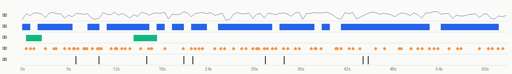

- loudness -16.8 dBFS, peak -2.1 dBFS; sound runs across cuts, laid in post as one bed (background changes 6.3dB at cuts vs 6.1dB within shots)
- Sources: Video type: live footage (location sound + music added in post) → voice: human recording; SFX: location sound

**Voice**

- 77% of the duration; pitch about 193.4Hz (gender unclear); sung
- Source: human recording (human_recording 73%, tts 20%, ai_video_native 7%)
  - 82% of the picture is live footage: the voice is most likely location sound or a human voice-over
- Remake: capsule-cinema DoubaoTTSTool / UniversalTTSTool (or a MiniMax cloned voice); use duration-controlled TTS when it must fit the original time window

**Music**

- No sustained music bed detected

**Sound effects** (78)

<details><summary>all 60 sound effects</summary>

| Time | Type | Description | On screen | Basis |
|---|---|---|---|---|
| 0.51s | ding | text label "roller" appears | subtitle "roller" appears | deterministic_anchored |
| 1.06s | whoosh | text label "loop" appears | subtitle "loop" appears | deterministic_anchored |
| 1.54s | ding | text label "out of" appears | subtitle "out of" appears | deterministic_anchored |
| 3.01s | ding | text label "filrst" appears | subtitle "filrst" appears | deterministic_anchored |
| 4.12s | whoosh | text label "to go" appears | subtitle "to go" appears | deterministic_anchored |
| 4.42s | ding | text label "psdn" appears | subtitle "psdn" appears | deterministic_anchored |
| 5.53s | whoosh | text label "it cost him" appears | subtitle "it cost him" appears | deterministic_anchored |
| 6.13s | pop | text label "everything." appears | Tiny fly at the worker face/wallet gag; visible graphic/object, whether 2D overlay or scene geometry unverified appears | deterministic_anchored |
| 6.69s | whoosh | — | — | signal candidate (low confidence) |
| 6.82s | whoosh | text label "course," appears | subtitle "course," appears | deterministic_anchored |
| 7.27s | whoosh | — | subtitle "his" appears | signal candidate (low confidence) |
| 8.01s | ding | text label "TNIVS LOOP" appears | subtitle "copies it" appears | deterministic_anchored |
| 8.14s | whoosh | text label "bolt" appears | subtitle "bolt" appears | deterministic_anchored |
| 8.39s | whoosh | — | text label "LOOP" appears | signal candidate (low confidence) |
| 9.12s | ding | text label "But" appears | subtitle "But" appears | deterministic_anchored |
| 9.81s | whoosh | text label "before" appears | subtitle "before" appears | deterministic_anchored |
| 10.00s | pop | text label "OPENING TOMOR" appears | subtitle "before" appears | deterministic_anchored |
| 10.29s | whoosh | — | subtitle "opening," appears | signal candidate (low confidence) |
| 11.56s | pop | text label "dummy" appears | subtitle "dummy" appears | deterministic_anchored |
| 12.12s | pop | text label "back" appears | subtitle "back" appears | deterministic_anchored |
| 12.32s | whoosh | text label "OPENING TOMOR" appears | subtitle "crushed" appears | deterministic_anchored |
| 12.95s | whoosh | text label "a soda can." appears | subtitle "a soda can." appears | deterministic_anchored |
| 13.42s | whoosh | text label "But" appears | subtitle "But" appears | deterministic_anchored |
| 14.00s | whoosh | text label "he can't" appears | subtitle "he can't" appears | deterministic_anchored |
| 15.41s | ding | text label "and" appears | subtitle "and" appears | deterministic_anchored |
| 16.48s | ding | text label "the bottom" appears | subtitle "the bottom" appears | deterministic_anchored |
| 16.86s | pop | text label "into a" appears | subtitle "into a" appears | deterministic_anchored |
| 18.58s | ding | — | subtitle "curve." appears | signal candidate (low confidence) |
| 20.93s | whoosh | text label "rival" appears | subtitle "rival" appears | deterministic_anchored |
| 22.04s | ding | text label "sneaks" appears | subtitle "sneaks" appears | deterministic_anchored |
| 22.50s | whoosh | text label "in and" appears | subtitle "in and" appears | deterministic_anchored |
| 23.01s | whoosh | text label "cranks" appears | subtitle "cranks" appears | deterministic_anchored |
| 23.43s | whoosh | text label "the sides" appears | subtitle "the sides" appears | deterministic_anchored |
| 25.08s | whoosh | — | subtitle "is tall" appears | signal candidate (low confidence) |
| 25.82s | ding | text label "SO7" appears | subtitle "SO7" appears | deterministic_anchored |
| 26.32s | ding | text label "the first cart" appears | subtitle "the first cart" appears | deterministic_anchored |
| 27.53s | ding | text label "twig." appears | subtitle "twig." appears | deterministic_anchored |
| 28.54s | whoosh | styled text "OTTONCANDY" appears | subtitle "morning," appears | deterministic_anchored |
| 29.13s | whoosh | text label "ANDY-" appears | — | deterministic_anchored |
| 29.98s | ding | text label "GRANDOPENING" appears | subtitle "rivals" appears | deterministic_anchored |
| 30.48s | ding | text label "perfect" appears | subtitle "perfect" appears | deterministic_anchored |
| 30.75s | whoosh | text label "circle." appears | subtitle "circle." appears | deterministic_anchored |
| 31.48s | ding | styled text "FIRST!" appears | subtitle "FIRST!" appears | deterministic_anchored |
| 31.92s | whoosh | text label "climbs" appears | subtitle "climbs" appears | deterministic_anchored |
| 32.57s | ding | text label "FIRST!·front" appears | subtitle "FIRST!·front" appears | deterministic_anchored |
| 33.02s | whoosh | — | subtitle "toshow" appears | signal candidate (low confidence) |
| 33.99s | pop | text label "climbs" appears | subtitle "climbs" appears | deterministic_anchored |
| 34.58s | ding | text label "into his," appears | subtitle "into his," appears | deterministic_anchored |
| 35.57s | ding | text label "UPSTR" appears | subtitle "UPSTR" appears | deterministic_anchored |
| 36.03s | whoosh | styled text "SIDE-DOV" appears | subtitle "over" appears | deterministic_anchored |
| 37.62s | whoosh | text label "sees" appears | subtitle "sees" appears | deterministic_anchored |
| 38.09s | ding | — | subtitle "tall" appears | signal candidate (low confidence) |
| 38.23s | whoosh | — | subtitle "skinny" appears | signal candidate (low confidence) |
| 38.87s | whoosh | — | subtitle "loop" appears | signal candidate (low confidence) |
| 40.83s | whoosh | — | subtitle "see," appears | signal candidate (low confidence) |
| 41.01s | whoosh | text label "see," appears | subtitle "see," appears | deterministic_anchored |
| 41.47s | ding | — | subtitle "a car" appears | signal candidate (low confidence) |
| 42.53s | ding | text label "hairpin" appears | subtitle "hairpin" appears | deterministic_anchored |
| 43.03s | whoosh | text label "at five," appears | subtitle "at five," appears | deterministic_anchored |
| 43.94s | whoosh | text label "take it at" appears | subtitle "take it at" appears | deterministic_anchored |

</details>

- Source: location sound (live_sync 65%, library_editor 24%, ai_native 12%)
  - The picture is mostly live footage: the ambience is most likely location sound
  - Cartoon SFX in 3D / animated videos are also often procedurally synthesised or added from a library (e.g. the capsule-cinema plush recipe synthesises them)
- Remake: Place by timestamp: capsule-cinema SoundEffectsTool / an SFX library, or synthesise procedurally like the plush recipe (pitched to the music key)

- Separated stems: `stems/original.wav` (original), `stems/vocals.wav` (dry voice; transient sound effects land here too), `stems/music.wav` (music + ambience)
<!--stems-->

## Camera, lighting and editing

- Visual style: Detailed coherent 3D world and physically readable props with expressive flat 2D illustrated characters. Visual inspection supports this grammar; exact production software and source assets remain unk
- Framing: shot size Varies within the detected group; see temporal breakdown 100%; camera angle Deliberate action-oriented virtual camera, including low views and POV where described; subject is the in-focus region (no face; shot size is an estimate)
- Camera: moving camera (gimbal / handheld pan) 100%; typical move push-in
- Lighting: outdoor soft light (overcast / open shade). Key light frontal (from the camera side; both sides of the subject about equally bright), from above (ceiling light / street lamp / high source); lighting ratio about 1.3:1 (0.3 stops); medium-soft; colour temperature neutral (about 5000K); subject and background differ in colour temperature: mixed sources (e.g. warm lamp + cool window light / screen); background clearly blurred (shallow depth of field / portrait mode)
- Grade: natural (close to the original colours); high saturation, normal contrast, normal blacks, overall cool
- Editing: 8.5 cuts per minute, 7.43s average live-action shot; 5 camera set-up(s) / location(s); 0 jump cut(s) and 0 punch-in(s) within the same set-up; inserts (screenshots / screen recordings / cards / stock) take 18%; 0% of cuts land in pauses of the speech
- Format: handheld product shots (unboxing / selling / POV) (face as subject 0%, objects / hands as subject 100%, handheld 100%); image readers: Narrated comic physics story with 3D environments/props, expressive flat illustrated cast, in-world mechanism demonstrations, road analogy and visual payoff; not a slideshow or generic explainer presenter.

**Shooting plan for the remake**

1. Format: handheld product shots
2. Framing: mostly Varies within the detected group; see temporal breakdown, Deliberate action-oriented virtual camera, including low views and POV where described
3. Camera: moving camera (gimbal / handheld pan) 100%; typical move push-in
4. Lighting: outdoor soft light (overcast / open shade) — overcast sky or the shade of a building: the sky is one huge soft source, almost no hard shadows
5. Editing: 8.5 cuts per minute, 7.43s average live-action shot; 5 camera set-up(s) / location(s); 0 jump cut(s) and 0 punch-in(s) within the same set-up; inserts (screenshots / screen recordings / cards / stock) take 18%; 0% of cuts land in pauses of the speech

Gear:
- place it in the shade facing the open sky
- white foam board to bounce light into the shadows
- Note: subject and background differ in colour temperature: mixed sources (e.g. warm lamp + cool window light / screen)
- Note: background clearly blurred (shallow depth of field / portrait mode)

<details><summary>Per-item measurements and image readings (22)</summary>

| Aspect | Item | Verdict | Sources |
|---|---|---|---|
| Framing | shot size | Varies within the detected group; see temporal breakdown | measured; agent review |
| Framing | camera angle | Deliberate action-oriented virtual camera, including low views and POV where described | agent review |
| Framing | composition | Actor or physical mechanism is the focal point; foreground, middle action and persistent background have separate depth. | agent review |
| Camera | camera support | Virtual 3D camera inferred from stable perspective/parallax | measured: moving camera (gimbal / handheld pan); agent review |
| Camera | lens | Actual focal length cannot be recovered; compare framing directly | agent review |
| Camera | speed | Purposeful dolly/tracking/reveal, with holds for reactions; not a uniform slow pan. | agent review |
| Camera | set-ups / locations | One coherent park with multiple purposeful virtual camera routes; short clearly motivated road analogy | agent review |
| Camera | likely gear | Exact software/renderer/camera unknown; Blender/Three.js is a proposed original rebuild route | agent review |
| Lighting | location | Stylized rendered exterior/station; not a live-action lighting plan | agent review |
| Lighting | key light | Daylight key or blue night fill with warm scene lamps depending on segment | agent review |
| Lighting | soft / hard | medium-soft | measured; agent review: Visible soft cast shadows and material separation |
| Lighting | fill | Ambient/environment fill inferred visually | agent review |
| Lighting | rim / backlight | Unverified | agent review |
| Lighting | catchlight | Illustrated eyes; do not invent real camera catchlights | agent review |
| Lighting | practicals | Night colored bulbs, station fixtures and lantern when present | agent review |
| Lighting | colour temperature | neutral (about 5000K) | measured; agent review: Exact Kelvin unverified |
| Lighting | lighting set-up | 3D lighting reconstruction, no physical equipment claim | agent review |
| Lighting | overall lighting | Day/night change serves narrative time. Warm practicals and sparks create night accents; vivid daylight preserves foliage and material contrast. | agent review |
| Grade | colour grade | natural (close to the original colours) | measured; agent review: Saturated blue/green daytime with warm props, contrasted with deep blue night and warm practical lights; retain material detail. |
| Grade | overall grade | Vivid daylight blue/green, saturated costume colors and textured materials; blue night with warm light pools. | agent review |
| Editing | editing style | Detected ten groups under-segment dissolves. Six extra approximate transition centers proposed; distinguish true scene changes from camera moves and acting beats. Captions are short white bold words/phrases with black outline around lower-middle screen. | agent review |
| Format | video format | Narrated comic physics story with 3D environments/props, expressive flat illustrated cast, in-world mechanism demonstrations, road analogy and visual payoff; not a slideshow or generic explainer presenter. | measured: handheld product shots (unboxing / selling / POV); agent review |

</details>

- Note: lighting ratio, soft / hard, colour temperature and shot size are measured on the subject's pixels (the face when there is one, otherwise the in-focus region, which is an estimate); platform transcodes crush the shadows, so hardness and fill read conservative; camera angle, light source, catchlight and rim light follow the image readers. Where measurement and readers disagree, both are listed.

## Packaging layer (subtitles / styled text / stickers / sound-effect hits)

- 117 subtitle lines (bottom/middle, up to 1 rows): white text, black outline, line height 4.3%; entrance: hard in×93, fade in×8, slide in×2, type-on×1
- Stickers / GIFs: Tiny fly at the worker face/wallet gag; visible graphic/object, whether 2D overlay or scene geometry unverified ×1, Golden rail glow/sparks synchronized visually with hammering and curvature change; animated explanatory effect ×1, Comic explosion behind the owner; volumetric simulation versus billboard/stock element unverified ×1
- SFX hits on: subtitle in ×72, sticker in ×2
- Exports: `packaging/subtitles.srt`, `packaging/overlays.ass`, `packaging/timeline.json` (SRT is the subtitle timeline; ASS carries colour, outline, position and entrance animation, swap in the original font; timeline.json is the full timeline)

<details><summary>text timeline (117 rows)</summary>

| Time | Kind | Text | Style | In / out | SFX |
|---|---|---|---|---|---|
| 0.00–0.20s | subtitle | bent | white text, black outline, line height 4.1% (about 78px) | hard out | — |
| 0.50–0.60s | subtitle | roller | white text, black outline, line height 3.7% (about 70px) | hard in / hard out | ding |
| 1.00–1.10s | subtitle | loop | white text, black outline, line height 4.3% (about 83px) | hard in / hard out | whoosh |
| 1.50–1.60s | subtitle | out of | white text, black outline, line height 3.8% (about 72px) | hard in / hard out | ding |
| 2.00–2.10s | subtitle | shape. | white text, black outline, line height 4.8% (about 92px) | hard in / hard out | — |
| 2.40–2.80s | subtitle | see, | white text, black outline, line height 4.4% (about 84px) | hard in / hard out | — |
| 3.00–3.10s | subtitle | filrst | white text, black outline, line height 4.4% (about 84px) | hard in / hard out | ding |
| 3.50–3.60s | subtitle | ever | white text, black outline, yellow box, line height 3.8% (about 72px) | hard in / hard out | — |
| 4.00–4.10s | subtitle | to go | white text, black outline, line height 5.1% (about 98px) | hard in / hard out | whoosh |
| 4.30–4.60s | subtitle | psdn | white text, black outline, line height 4.6% (about 89px) | hard in / hard out | ding |
| 5.00–5.10s | subtitle | and | white text, black outline, line height 4.3% (about 83px) | hard in / hard out | — |
| 5.50–5.70s | subtitle | it cost him | white text, black outline, line height 4.5% (about 85px) | hard in | whoosh |
| 6.00–6.60s | subtitle | everything. | white text, black outline, brown box, line height 4.6% (about 88px) | fade out | — |
| 6.90–7.10s | subtitle | course, | white text, black outline, line height 4.5% (about 85px) | slide in / hard out | whoosh |
| 7.20–7.60s | subtitle | his | white text, black outline, line height 4.9% (about 94px) | hard out | whoosh |
| 8.00–8.10s | subtitle | copies it | white text, black outline, line height 4.2% (about 81px) | hard in / hard out | ding |
| 8.10–9.10s | subtitle | bolt | white text, black outline, line height 3.9% (about 74px) | hard out | whoosh |
| 9.10–9.90s | subtitle | But | white text, black outline, line height 3.7% (about 70px) | hard out | ding |
| 9.90–10.20s | subtitle | before | white text, black outline, line height 3.9% (about 75px) | hard out | whoosh, pop |
| 10.30–10.60s | subtitle | opening, | white text, black outline, line height 3.8% (about 74px) | fade in / hard out | whoosh |
| 11.00–11.50s | subtitle | test | white text, black outline, red box, line height 3.6% (about 69px) | hard in | — |
| 11.50–11.70s | subtitle | dummy | white text, black outline, line height 4.4% (about 84px) | hard in / hard out | pop |
| 12.00–12.10s | subtitle | back | white text, black outline, purple box, line height 3.9% (about 75px) | hard in / hard out | pop |
| 12.50–12.60s | subtitle | crushed | white text, black outline, line height 3.7% (about 70px) | hard in / hard out | whoosh |
| 13.00–13.10s | subtitle | a soda can. | white text, line height 3.0% (about 59px) | hard in / hard out | whoosh |
| 13.50–13.60s | subtitle | But | white text, black outline, line height 4.0% (about 76px) | hard in / hard out | whoosh |
| 14.00–14.10s | subtitle | he can't | white text, black outline, line height 3.7% (about 70px) | hard in / hard out | whoosh |
| 14.50–14.60s | subtitle | the opening | white text, black outline, line height 4.5% (about 87px) | hard in / hard out | — |
| 15.00–15.10s | subtitle | Sohe | white text, black outline, line height 4.3% (about 83px) | hard in / hard out | — |
| 15.40–16.20s | subtitle | and | white text, black outline, blue box, line height 3.5% (about 68px) | type-on / hard out | ding |
| 16.40–16.70s | subtitle | the bottom | white text, black outline, line height 3.8% (about 74px) | hard in | ding |
| 16.90–17.20s | subtitle | into a | black text, white outline, orange box, keywords highlighted in orange, line height 5.1% (about 98px) | hard in / hard out | pop |
| 17.50–18.00s | subtitle | Iong, | white text, black outline, line height 5.4% (about 103px) | hard in | — |
| 18.00–18.10s | subtitle | lazy | white text, black outline, line height 4.9% (about 94px) | hard in / hard out | — |
| 18.50–18.60s | subtitle | curve. | white text, black outline, line height 3.6% (about 69px) | hard in / hard out | ding |
| 19.00–19.10s | subtitle | he know | white text, black outline, line height 4.1% (about 78px) | hard in / hard out | — |
| 19.50–19.60s | subtitle | doing? | white text, black outline, blue box, line height 4.8% (about 92px) | hard in / hard out | — |
| 20.00–20.90s | subtitle | Not really. | white text, black outline, line height 4.4% (about 84px) | fade in / hard out | — |
| 21.00–21.10s | subtitle | rival | white text, black outline, line height 4.2% (about 81px) | hard in / hard out | whoosh |
| 21.50–21.60s | subtitle | laughs, | white text, black outline, line height 4.8% (about 92px) | hard in / hard out | — |
| 22.00–22.10s | subtitle | sneaks | white text, black outline, line height 3.7% (about 70px) | hard in / hard out | ding |
| 22.50–22.60s | subtitle | in and | white text, black outline, line height 3.7% (about 70px) | hard in / hard out | whoosh |
| 23.00–23.10s | subtitle | cranks | white text, black outline, line height 3.7% (about 70px) | hard in / hard out | whoosh |
| 23.50–23.60s | subtitle | the sides | white text, black outline, line height 3.8% (about 74px) | hard in / hard out | whoosh |
| 24.00–24.10s | subtitle | cuntil | white text, black outline, line height 4.7% (about 90px) | hard in / hard out | — |
| 24.50–24.60s | subtitle | loop | white text, black outline, line height 4.9% (about 94px) | hard in / hard out | — |
| 25.00–25.20s | subtitle | is tall | white text, black outline, line height 4.2% (about 81px) | hard in / hard out | whoosh |
| 25.30–25.80s | subtitle | and skinny. | white text, black outline, line height 4.8% (about 92px) | hard in / hard out | — |
| 25.90–26.10s | subtitle | SO7 | white text, black outline, line height 5.2% (about 99px) | hard in / hard out | ding |
| 26.40–26.70s | subtitle | the first cart | white text, black outline, line height 3.8% (about 74px) | hard in / hard out | ding |
| 27.00–27.10s | subtitle | snap | white text, black outline, line height 4.2% (about 81px) | hard in / hard out | — |
| 27.50–27.60s | subtitle | twig. | white text, black outline, line height 5.7% (about 109px) | hard in / hard out | ding |
| 28.00–28.20s | subtitle | The next | white text, black outline, line height 4.3% (about 83px) | hard in / hard out | — |
| 28.50–28.60s | subtitle | morning, | white text, black outline, line height 4.7% (about 90px) | hard in / hard out | whoosh |
| 28.90–29.10s | subtitle | town | white text, black outline, bold, line height 3.6% (about 69px) | hard in / hard out | — |
| 29.50–29.60s | subtitle | lines | white text, black outline, line height 4.0% (about 76px) | hard in / hard out | — |
| 30.00–30.10s | subtitle | rivals | white text, black outline, line height 3.8% (about 72px) | hard in / hard out | ding |
| 30.00–30.10s | subtitle | IIIIN | brown text, brown outline, line height 1.9% (about 37px) | hard in / hard out | — |
| 30.50–30.60s | subtitle | perfect | white text, black outline, line height 4.5% (about 87px) | hard in / hard out | ding |
| 30.70–31.20s | subtitle | circle. | white text, black outline, line height 3.7% (about 70px) | hard in / hard out | whoosh |
| 31.30–31.60s | subtitle | and the | white text, black outline, yellow box, bold, line height 3.7% (about 70px) | fade in / hard out | — |
| 31.50–32.20s | subtitle | FIRST! | red text, keywords highlighted in brown, line height 3.5% (about 67px) | fade in / fade out | ding |
| 31.80–32.20s | subtitle | climbs | white text, black outline, line height 4.3% (about 83px) | hard in / hard out | whoosh |
| 32.50–32.60s | subtitle | FIRST!·front | white text, black outline, keywords highlighted in red, line height 4.7% (about 90px) | hard in / hard out | ding |
| 33.00–33.20s | subtitle | toshow | white text, black outline, line height 4.1% (about 79px) | hard in / fade out | whoosh |
| 33.30–33.90s | subtitle | The | white text, black outline, line height 4.8% (about 92px) | hard in | — |
| 33.90–34.10s | subtitle | climbs | white text, black outline, line height 3.7% (about 70px) | hard out | pop |
| 34.50–34.60s | subtitle | into his, | white text, black outline, line height 5.1% (about 98px) | hard in / hard out | ding |
| 34.90–35.10s | subtitle | as his | white text, black outline, line height 4.4% (about 84px) | hard in / hard out | — |
| 35.50–35.60s | subtitle | UPSTR | grey text, keywords highlighted in white, line height 6.7% (about 129px) | hard in / hard out | ding |
| 35.50–35.60s | subtitle | cart | white text, black outline, blue box, line height 4.5% (about 85px) | hard in / hard out | — |
| 36.00–37.10s | subtitle | over | white text, black outline, line height 4.8% (about 93px) | hard in / hard out (bounces / changes colour midway) | whoosh |
| 37.50–37.60s | subtitle | sees | white text, black outline, line height 3.1% (about 60px) | hard in / hard out | whoosh |
| 38.00–38.10s | subtitle | tall | white text, black outline, line height 3.9% (about 75px) | hard in / hard out | ding |
| 38.40–38.60s | subtitle | skinny | white text, black outline, line height 4.5% (about 85px) | hard in / hard out | whoosh |
| 38.70–39.20s | subtitle | loop | white text, black outline, black box, line height 4.3% (about 83px) | fade in / fade out | whoosh |
| 39.50–39.60s | subtitle | ahead. | white text, black outline, line height 3.4% (about 65px) | hard in / hard out | — |
| 40.00–40.10s | subtitle | it's | white text, black outline, line height 4.5% (about 87px) | hard in / hard out | — |
| 40.50–40.70s | subtitle | late. | white text, black outline, line height 3.8% (about 72px) | hard in / hard out | — |
| 41.00–41.10s | subtitle | see, | white text, black outline, line height 3.9% (about 75px) | hard in / hard out | whoosh, whoosh |
| 41.40–41.80s | subtitle | a car | white text, black outline, line height 3.8% (about 74px) | hard in / hard out | ding |
| 42.00–42.30s | subtitle | creep | white text, black outline, line height 4.5% (about 87px) | hard in / hard out | — |
| 42.50–42.60s | subtitle | hairpin | white text, black outline, line height 5.0% (about 96px) | hard in / hard out | ding |
| 43.00–43.80s | subtitle | at five, | white text, black outline, line height 5.0% (about 96px) | fade out | whoosh |
| 44.00–44.20s | subtitle | take it at | white text, black outline, line height 3.8% (about 74px) | hard in / hard out | whoosh |
| 44.40–45.60s | subtitle | flips. | white text, black outline, line height 5.1% (about 98px) | hard in / hard out (bounces / changes colour midway) | — |
| 46.00–46.10s | subtitle | Acart | white text, black outline, line height 4.5% (about 87px) | hard in / hard out | whoosh |
| 46.50–46.60s | subtitle | fastest | white text, black outline, line height 4.6% (about 89px) | hard in / hard out | — |
| 46.60–47.10s | subtitle | bottom | white text, black outline, line height 4.5% (about 87px) | hard in / hard out | — |
| 47.20–47.60s | subtitle | a loop | white text, black outline, line height 5.4% (about 103px) | hard in / hard out | pop |
| 47.90–48.10s | subtitle | anda | white text, black outline, line height 4.5% (about 85px) | hard out | — |
| 48.50–48.60s | subtitle | circle | white text, black outline, line height 4.5% (about 87px) | hard in / hard out | — |
| 49.00–49.20s | subtitle | puts | white text, black outline, line height 5.2% (about 99px) | hard in / hard out | ding |
| 49.40–49.70s | subtitle | a hairpin | white text, black outline, line height 4.4% (about 84px) | hard in / hard out | whoosh |
| 50.00–50.10s | subtitle | there, | white text, black outline, line height 5.0% (about 96px) | hard in / hard out | — |
| 50.50–50.60s | subtitle | which is | white text, black outline, line height 4.1% (about 79px) | hard in / hard out | whoosh |
| 50.90–51.40s | subtitle | crushed | white text, black outline, line height 4.6% (about 89px) | — | — |
| 51.40–51.80s | subtitle | the dummy. | white text, black outline, line height 4.8% (about 92px) | hard in / fade out | ding |
| 51.90–52.10s | subtitle | his hammer | white text, black outline, line height 4.4% (about 84px) | hard out | ding |
| 52.40–52.60s | subtitle | made | white text, black outline, keywords highlighted in orange, line height 4.2% (about 81px) | fade in / hard out | — |
| 53.00–53.10s | subtitle | bottom | white text, black outline, line height 4.0% (about 76px) | hard in / hard out | whoosh |
| 53.50–53.60s | subtitle | gentle | white text, black outline, brown box, line height 5.0% (about 96px) | hard in / hard out | whoosh |
| 54.00–54.40s | subtitle | rival's | white text, black outline, line height 4.8% (about 93px) | hard in | pop |
| 54.40–54.70s | subtitle | squeeze | white text, black outline, line height 3.6% (about 69px) | hard out | — |
| 55.00–56.10s | subtitle | up top | white text, black outline, line height 4.6% (about 89px) | fade in / fade out (bounces / changes colour midway) | — |
| 56.50–56.60s | subtitle | the cart | white text, black outline, line height 4.5% (about 85px) | hard in / hard out | whoosh |
| 57.00–57.10s | subtitle | crawling. | white text, black outline, line height 5.0% (about 96px) | hard in / hard out | — |
| 57.10–57.60s | subtitle | So | white text, black outline, line height 5.2% (about 99px) | hard out | whoosh |
| 58.00–58.10s | subtitle | he floats | white text, black outline, red box, line height 4.1% (about 79px) | hard in / hard out | — |
| 58.50–58.60s | subtitle | without | white text, black outline, line height 3.8% (about 74px) | hard in / hard out | — |
| 59.00–59.10s | subtitle | scratch. | white text, black outline, line height 4.5% (about 87px) | hard in / hard out | — |
| 59.50–59.60s | subtitle | Justas | white text, black outline, line height 4.2% (about 81px) | hard in / hard out | whoosh |
| 59.80–60.10s | subtitle | rival's | white text, black outline, line height 4.1% (about 79px) | slide in / hard out | — |
| 60.50–60.60s | subtitle | cart | white text, black outline, line height 4.1% (about 79px) | hard in / hard out | ding |
| 61.00–61.80s | subtitle | the bottom | white text, black outline, orange box, line height 4.1% (about 79px) | fade in | — |
| 62.00–62.10s | subtitle | perfect | white text, black outline, line height 5.2% (about 99px) | hard in / hard out | pop |
| 62.50–62.80s | subtitle | circle. | white text, black outline, line height 4.9% (about 94px) | hard in / fade out | whoosh |

</details>

**Stickers / GIFs / picture-in-picture**

| Time | Kind | Position | Motion | Confidence | Crop |
|---|---|---|---|---|---|
| 6.20–6.80s | Tiny fly at the worker face/wallet gag; visible graphic/object, whether 2D overlay or scene geometry unverified | Near center of extreme face closeup | static | confirmed | — |
| 16.30–18.70s | Golden rail glow/sparks synchronized visually with hammering and curvature change; animated explanatory effect | Along lower coaster curve | static | confirmed | — |
| 61.10–63.17s | Comic explosion behind the owner; volumetric simulation versus billboard/stock element unverified | Background rival ride, then large upper image | static | confirmed | — |

Remake: burn subtitles and styled text in with `packaging/overlays.ass` (ffmpeg -vf ass=overlays.ass), or rebuild them from timeline.json in CapCut / Remotion; stickers and GIFs need matching assets (meme / GIF libraries), crops are under packaging/.

## Remake plan

**2 3D render shots + 1 AI video shot → 3 generation units, 3 Seedance 2.5 calls; live action 7 shots → 2 scenes, 2 camera setups**

- The default engine Seedance 2.0（含 Mini / Fast） cannot generate several shots in one call; with it you would generate shot by shot, 3 times. This plan is for Seedance 2.5 (≤30s per call, multi-shot in one call), 3 calls in total
- Grouping: AI shots in the same scene joined by hard cuts are generated in one call; ≤30s per call; consecutive hard cuts inside a unit preferably ≤8s, at most 10s; split at dissolves / fades and scene changes
- Audio: the model can generate action sound effects and ambience along with the picture; voice-over is better done as separate TTS and mixed in, so copy and timing stay editable

### Generation units

| Unit | Shots | Time | Duration | Mode | Continuity |
|---|---|---|---|---|---|
| G1 | #1 | 0.0–7.0s | 7.0s | single shot | first frame: generate an image matching the composition of source shot 1's first frame (shots/shot_001_first.jpg) |
| G2 | #2 | 7.0–10.0s | 3.0s | single shot | first frame: generate an image matching the composition of source shot 2's first frame (shots/shot_002_first.jpg) |
| G3 | #5 | 21.0–22.2s | 1.2s | single shot | first frame: generate an image matching the composition of source shot 5's first frame (shots/shot_005_first.jpg) |

**G1 · 3D render · shots #1 · 7.0s**

- References: `@图片1` character reference images (one frontal face + one half-body per character) so the look stays consistent across shots; `@视频1` source clip 0.0–7.0s: reference for action, camera movement and cutting rhythm (reference only, do not copy the picture)
- First-frame image prompt: Original detailed stylized 3D environment with physically coherent materials, support structures and layered depth, expressive flat illustrated cast with costume-specific seams and accessories. Preserve readable action and the actual local framing.
- Alternative: a 3D project. Have an LLM write a Blender script or a Three.js scene; model the characters / props once and render each shot from its own camera. Best for multiple angles and character consistency, and changing copy or shots is just a code change

```text
Vertical 9:16; outdoor soft light (overcast / open shade), soft light (almost no lit / shadow edge), cool (daylight / cool-white LED), background clearly blurred (shallow depth of field / portrait mode). Characters follow @图片1. Follow the action, camera movement and cutting rhythm of @视频1.
At 0-2.63s a patched-overall worker raises, swings and lands a long sledgehammer on a detailed steel coaster. The torso leans, face compresses and sparks mark contact. Camera rapidly dollies back to reveal the huge loop, then dissolves at about 2.63s to a moving scaffold view. From 5.3s camera pushes into an opened empty wallet and facial disappointment; a tiny fly is a visual gag. This is multiple staging beats in a rendered 3D park with a flat illustrated actor, not documentary footage. For an original adaptation, author the required geometry and physical acting in Blender/Three.js; stage anticipation, contact, follow-through and reaction. This is a code/3D reconstruction brief, not permission for image/video generation.
```

<details><summary>English prompt</summary>

```text
At 0-2.63s a patched-overall worker raises, swings and lands a long sledgehammer on a detailed steel coaster. The torso leans, face compresses and sparks mark contact. Camera rapidly dollies back to reveal the huge loop, then dissolves at about 2.63s to a moving scaffold view. From 5.3s camera pushes into an opened empty wallet and facial disappointment; a tiny fly is a visual gag. This is multiple staging beats in a rendered 3D park with a flat illustrated actor, not documentary footage.
```

</details>

**G2 · 3D render · shots #2 · 3.0s**

- References: `@图片1` character reference images (one frontal face + one half-body per character) so the look stays consistent across shots; `@视频1` source clip 7.0–10.0s: reference for action, camera movement and cutting rhythm (reference only, do not copy the picture)
- First-frame image prompt: Original detailed stylized 3D environment with physically coherent materials, support structures and layered depth, expressive flat illustrated cast with costume-specific seams and accessories. Preserve readable action and the actual local framing.
- Generate 4s and trim to 3.0s (very short shots are unstable when generated on their own)
- Alternative: a 3D project. Have an LLM write a Blender script or a Three.js scene; model the characters / props once and render each shot from its own camera. Best for multiple angles and character consistency, and changing copy or shots is just a code change

```text
Vertical 9:16; outdoor soft light (overcast / open shade), soft light (almost no lit / shadow edge), cool (daylight / cool-white LED), background clearly blurred (shallow depth of field / portrait mode). Characters follow @图片1. Follow the action, camera movement and cutting rhythm of @视频1.
A cream-waistcoated rival stands beside a blueprint board, construction crane and partly assembled white circular loop. Camera approaches from wide park geography to readable character and board; eyes/brows/mouth change from smug to speaking. Trees, wheel, fences and bunting give depth and continuity. Different character costume, same flat illustrated family. For an original adaptation, author the required geometry and physical acting in Blender/Three.js; stage anticipation, contact, follow-through and reaction. This is a code/3D reconstruction brief, not permission for image/video generation.
```

<details><summary>English prompt</summary>

```text
A cream-waistcoated rival stands beside a blueprint board, construction crane and partly assembled white circular loop. Camera approaches from wide park geography to readable character and board; eyes/brows/mouth change from smug to speaking. Trees, wheel, fences and bunting give depth and continuity. Different character costume, same flat illustrated family.
```

</details>

**G3 · AI-generated video · shots #5 · 1.2s**

- References: `@图片1` character reference images (one frontal face + one half-body per character) so the look stays consistent across shots; `@视频1` source clip 21.0–22.2s: reference for action, camera movement and cutting rhythm (reference only, do not copy the picture)
- First-frame image prompt: Original detailed stylized 3D environment with physically coherent materials, support structures and layered depth, expressive flat illustrated cast with costume-specific seams and accessories. Preserve readable action and the actual local framing.
- Generate 4s and trim to 1.2s (very short shots are unstable when generated on their own)

```text
Vertical 9:16; outdoor soft light (overcast / open shade), soft light (almost no lit / shadow edge), cool (daylight / cool-white LED), background clearly blurred (shallow depth of field / portrait mode). Characters follow @图片1. Follow the action, camera movement and cutting rhythm of @视频1.
Rival observes through a long telescope on tripod, turns toward the viewer and laughs with head and torso tilt. Warm hanging lantern makes a pool of light on grass; the loop and wheel remain behind him in blue night light. A short character reaction bridges the engineering action and sabotage. For an original adaptation, author the required geometry and physical acting in Blender/Three.js; stage anticipation, contact, follow-through and reaction. This is a code/3D reconstruction brief, not permission for image/video generation.
```

<details><summary>English prompt</summary>

```text
Rival observes through a long telescope on tripod, turns toward the viewer and laughs with head and torso tilt. Warm hanging lantern makes a pool of light on grass; the loop and wheel remain behind him in blue night light. A short character reaction bridges the engineering action and sabotage.
```

</details>

### Shooting scenes

Shoot every shot of one scene before moving to the next; within a scene, shoot the wider sizes first and the close-ups last so the lighting is set only once. Leave about 1s of handle at both ends of every take.

**S1**: shots #3, #4, #6, #7, #8 (33.13s on screen); Night test at the wooden station: cart moves into the foreground; printed crushed test-dummy material is visibly inside, worker reacts with wide eyes. Camera tracks beside rails then pushes toward worried worker; by 15.3s worker reaches for an upright sledgehammer and leans into the grip. Rail sleepers, plank grain, handrails, rope, banner, bin/stump and fluorescent/colored practical lights stay spatially fixed.
- Lighting: outdoor soft light (overcast / open shade), frontal (from the camera side; both sides of the subject about equally bright), about 1.2:1 (0.3 stops), cool (daylight / cool-white LED)
- Setup Varies within the detected group; see temporal breakdown · moving camera (gimbal / handheld pan) · push-in: shots #3, #4, #6, #7, #8, 33.13s on screen, shoot about 43.1s

**S2**: shots #9, #10 (18.87s on screen); At about 44.3s dissolve to an elevated rear chase view of a red open car and other traffic approaching the same road hairpin faster. Vehicle yaw, outward drift and the first skid begin; the animation continues into detector group 10. Dust/smoke here is a visible effect; exact audio identity remains unverified.
- Lighting: outdoor backlight (sun or bright sky behind the subject), frontal (from the camera side; both sides of the subject about equally bright), about 1.1:1 (0.1 stops), cool (daylight / cool-white LED)
- Setup Varies within the detected group; see temporal breakdown · moving camera (gimbal / handheld pan) · push-in: shots #9, #10, 18.87s on screen, shoot about 22.9s

### Real material in the picture (the original files are needed)

7 shots, 52.0s (82%) contain real material (screen recordings, screenshots, photos, embedded video); a model cannot stand in for them:

- Shot #3 (00:09.967): live footage, whole frame
- Shot #4 (00:16.167): live footage, whole frame
- Shot #6 (00:22.200): live footage, whole frame
- Shot #7 (00:31.633): live footage, whole frame
- Shot #8 (00:34.067): live footage, whole frame
- Shot #9 (00:44.300): live footage, whole frame
- Shot #10 (00:45.000): live footage, whole frame

## Shot list

| # | Time | Length | Base picture | Material | Overlays | Camera | Picture | Remake |
|---|---|---|---|---|---|---|---|---|
| 1 | 00:00.000 | 6.97s | 3D render 74% | rendered by the creator | subtitle, static sticker | smooth move | At 0-2.63s a patched-overall worker rais… | AI generation / 3D render · G1 |
| 2 | 00:06.967 | 3.00s | 3D render 74% | rendered by the creator | subtitle, text | smooth move | A cream-waistcoated rival stands beside … | AI generation / 3D render · G2 |
| 3 | 00:09.967 | 6.20s | live action 56% | the user's real material: live footage | subtitle | smooth move | Night test at the wooden station: cart m… | reshoot · S1 |
| 4 | 00:16.167 | 4.83s | live action 56% | the user's real material: live footage | subtitle, animated sticker / GIF | smooth move | Night hammering: an exaggerated body/arm… | reshoot · S1 |
| 5 | 00:21.000 | 1.20s | AI-generated video 54% | AI-generated | subtitle | smooth move | Rival observes through a long telescope … | AI generation (first / last frame) · G3 |
| 6 | 00:22.200 | 9.43s | live action 50% | the user's real material: live footage | subtitle, text | smooth move | At night the sleeping worker remains in … | reshoot · S1 |
| 7 | 00:31.633 | 2.43s | live action 46% | the user's real material: live footage | subtitle, text | smooth move | At the rival station a queue of distinct… | reshoot · S1 |
| 8 | 00:34.067 | 10.23s | live action 56% | the user's real material: live footage | subtitle | smooth move | Owner boards his cart, the camera rides/… | reshoot · S1 |
| 9 | 00:44.300 | 0.70s | live action 56% | the user's real material: live footage | subtitle | smooth move | At about 44.3s dissolve to an elevated r… | reshoot · S2 |
| 10 | 00:45.000 | 18.17s | live action 57% | the user's real material: live footage | subtitle, static sticker | smooth move | Continuation of the fast road car: it st… | reshoot · S2 |

## Open questions

- Shot #3 (10.0–16.2s): Tools say live action, the image review says 3D render; on the AI / live-action axis the fusion follows the tools (eval-calibrated): check the frames to see whether the review's evidence is really visible
- Shot #4 (16.2–21.0s): Tools say live action, the image review says 3D render; on the AI / live-action axis the fusion follows the tools (eval-calibrated): check the frames to see whether the review's evidence is really visible
- Shot #5 (21.0–22.2s): AI or live action, to confirm: only a sharpness rhythm, no duplicate frames (re-encodes leave it too) and no AIGC label, needs an image reader
- Shot #6 (22.2–31.6s): Tools say live action, the image review says 3D render; on the AI / live-action axis the fusion follows the tools (eval-calibrated): check the frames to see whether the review's evidence is really visible
- Shot #7 (31.6–34.1s): Tools say live action, the image review says 3D render; on the AI / live-action axis the fusion follows the tools (eval-calibrated): check the frames to see whether the review's evidence is really visible
- Shot #8 (34.1–44.3s): Tools say live action, the image review says 3D render; on the AI / live-action axis the fusion follows the tools (eval-calibrated): check the frames to see whether the review's evidence is really visible
- Shot #9 (44.3–45.0s): Tools say live action, the image review says 3D render; on the AI / live-action axis the fusion follows the tools (eval-calibrated): check the frames to see whether the review's evidence is really visible
- Shot #10 (45.0–63.2s): Tools say live action, the image review says 3D render; on the AI / live-action axis the fusion follows the tools (eval-calibrated): check the frames to see whether the review's evidence is really visible

## Appendix

### Shot by shot

Evidence, probabilities, text tracks and prompts per shot. Folded by default.

<details><summary>#1 00:00.000–00:06.967 · 3D render + code / editor overlays (subtitles, static sticker)</summary>

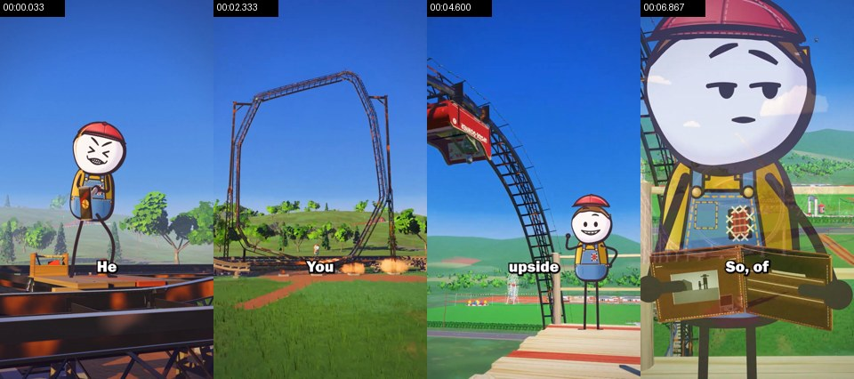

- Probabilities: 3D render 68%, AI-generated video 13%, 2D animation 5%（fused_agent）
- Material: rendered by the creator
- Photographic texture: noise σ=0.16, 352 colours, 20% flat blocks
- The whole file is native 30fps and photographic shots carry no 24fps-source duplicate frames (98% of the duration): typical of straight-from-phone footage, generators mostly output 24fps
- Temporal noise 0.94, 43% of pixels unchanged frame to frame: sensor noise is present, consistent with live action
- [Codex-visual-review review] Agent inspected all ten tool shot sheets, a whole-video 254-frame sample sequence at approximately 0.25-second intervals, and selected native-resolution details.
- [Codex-visual-review review] Stable rail/support topology, fixed scene landmarks and coherent parallax across moving camera views support a rendered 3D world; faces and clothing are deliberately flat illustrated characters.
- [Codex-visual-review review] No creator source project was supplied: the exact engine, asset provenance, rigging software and whether AI assisted authoring cannot be proven from the encoded clip. Do not infer live action merely from pixel statistics.
- [Codex-visual-review review] This shot looks like several cuts merged; suggest splitting at 00:02.630 (3D render→3D render): Approximate visually reviewed scene transitions/dissolve centers; detector merged these. Continuous camera moves inside a scene are described as beats, not additional cuts.
- Picture: At 0-2.63s a patched-overall worker raises, swings and lands a long sledgehammer on a detailed steel coaster. The torso leans, face compresses and sparks mark contact. Camera rapidly dollies back to reveal the huge loop, then dissolves at about 2.63s to a moving scaffold view. From 5.3s camera pushes into an opened empty wallet and facial disappointment; a tiny fly is a visual gag. This is multiple staging beats in a rendered 3D park with a flat illustrated actor, not documentary footage.
- Camera / lighting: Varies within the detected group; see temporal breakdown; Deliberate action-oriented virtual camera, including low views and POV where described; Virtual 3D camera inferred from stable perspective/parallax; outdoor soft light (overcast / open shade); key light frontal (from the camera side; both sides of the subject about equally bright); lighting ratio about 1.1:1 (0.2 stops); soft light (almost no lit / shadow edge)
- Text track (subtitle/bottom): He / You / upside / So, of
- Remake: 3D render: AI first/last-frame generation gives an approximation; for precise multiple angles, model in 3D and render in Blender
  - First-frame image prompt: Original detailed stylized 3D environment with physically coherent materials, support structures and layered depth, expressive flat illustrated cast with costume-specific seams and accessories. Preserve readable action and the actual local framing.
  - Video prompt: At 0-2.63s a patched-overall worker raises, swings and lands a long sledgehammer on a detailed steel coaster. The torso leans, face compresses and sparks mark contact. Camera rapidly dollies back to reveal the huge loop, then dissolves at about 2.63s to a moving scaffold view. From 5.3s camera pushes into an opened empty wallet and facial disappointment; a tiny fly is a visual gag. This is multiple staging beats in a rendered 3D park with a flat illustrated actor, not documentary footage. For an original adaptation, author the required geometry and physical acting in Blender/Three.js; stage anticipation, contact, follow-through and reaction. This is a code/3D reconstruction brief, not permission for image/video generation.

</details>

<details><summary>#2 00:06.967–00:09.967 · 3D render + code / editor overlays (subtitles, text labels)</summary>

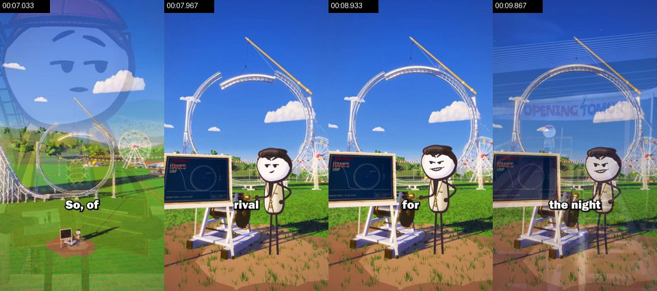

- Probabilities: 3D render 68%, AI-generated video 18%, 2D animation 5%（fused_agent）
- Material: rendered by the creator
- Photographic texture: noise σ=0.15, 364 colours, 21% flat blocks
- [Codex-visual-review review] Agent inspected all ten tool shot sheets, a whole-video 254-frame sample sequence at approximately 0.25-second intervals, and selected native-resolution details.
- [Codex-visual-review review] Stable rail/support topology, fixed scene landmarks and coherent parallax across moving camera views support a rendered 3D world; faces and clothing are deliberately flat illustrated characters.
- [Codex-visual-review review] No creator source project was supplied: the exact engine, asset provenance, rigging software and whether AI assisted authoring cannot be proven from the encoded clip. Do not infer live action merely from pixel statistics.
- Picture: A cream-waistcoated rival stands beside a blueprint board, construction crane and partly assembled white circular loop. Camera approaches from wide park geography to readable character and board; eyes/brows/mouth change from smug to speaking. Trees, wheel, fences and bunting give depth and continuity. Different character costume, same flat illustrated family.
- Camera / lighting: Varies within the detected group; see temporal breakdown; Deliberate action-oriented virtual camera, including low views and POV where described; Virtual 3D camera inferred from stable perspective/parallax; outdoor soft light (overcast / open shade); key light frontal (from the camera side; both sides of the subject about equally bright); lighting ratio about 1.2:1 (0.2 stops); soft light (almost no lit / shadow edge)
- Text track (subtitle/bottom): So, of / rlval / for / the night
- Text track (subtitle/middle): HNV'S / LOOP / TNIVS / TANNG
- Text track (text/middle): OPENING TO
- Remake: 3D render: AI first/last-frame generation gives an approximation; for precise multiple angles, model in 3D and render in Blender
  - First-frame image prompt: Original detailed stylized 3D environment with physically coherent materials, support structures and layered depth, expressive flat illustrated cast with costume-specific seams and accessories. Preserve readable action and the actual local framing.
  - Video prompt: A cream-waistcoated rival stands beside a blueprint board, construction crane and partly assembled white circular loop. Camera approaches from wide park geography to readable character and board; eyes/brows/mouth change from smug to speaking. Trees, wheel, fences and bunting give depth and continuity. Different character costume, same flat illustrated family. For an original adaptation, author the required geometry and physical acting in Blender/Three.js; stage anticipation, contact, follow-through and reaction. This is a code/3D reconstruction brief, not permission for image/video generation.

</details>

<details><summary>#3 00:09.967–00:16.167 · live action + code / editor overlays (subtitles); brings in real material (live footage)</summary>

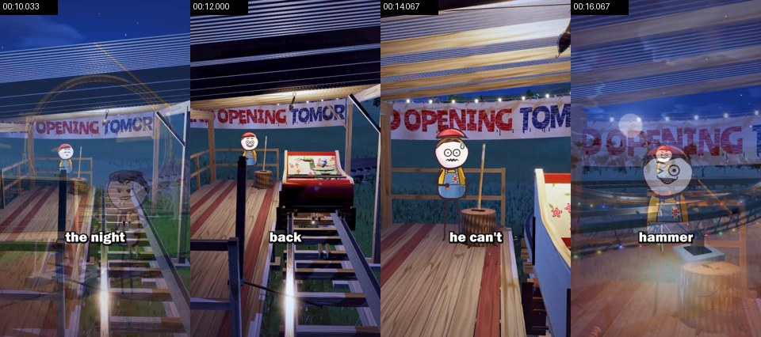

- Probabilities: live action 56%, AI-generated video 22%, 3D render 12%（fused_agent）
- ⚠️ Disputed: Tools say live action, the image review says 3D render; on the AI / live-action axis the fusion follows the tools (eval-calibrated): check the frames to see whether the review's evidence is really visible
- Text on objects in the scene (not subtitles): OPENING TOMOR, OPENING TOM, PENTNG
- Material: the user's real material: live footage
- Photographic texture: noise σ=0.47, 223 colours, 7% flat blocks
- The whole file is native 30fps and photographic shots carry no 24fps-source duplicate frames (98% of the duration): typical of straight-from-phone footage, generators mostly output 24fps
- Temporal noise 1.50, 19% of pixels unchanged frame to frame: sensor noise is present, consistent with live action
- [Codex-visual-review review] Agent inspected all ten tool shot sheets, a whole-video 254-frame sample sequence at approximately 0.25-second intervals, and selected native-resolution details.
- [Codex-visual-review review] Stable rail/support topology, fixed scene landmarks and coherent parallax across moving camera views support a rendered 3D world; faces and clothing are deliberately flat illustrated characters.
- [Codex-visual-review review] No creator source project was supplied: the exact engine, asset provenance, rigging software and whether AI assisted authoring cannot be proven from the encoded clip. Do not infer live action merely from pixel statistics.
- Picture: Night test at the wooden station: cart moves into the foreground; printed crushed test-dummy material is visibly inside, worker reacts with wide eyes. Camera tracks beside rails then pushes toward worried worker; by 15.3s worker reaches for an upright sledgehammer and leans into the grip. Rail sleepers, plank grain, handrails, rope, banner, bin/stump and fluorescent/colored practical lights stay spatially fixed.
- Camera / lighting: Varies within the detected group; see temporal breakdown; Deliberate action-oriented virtual camera, including low views and POV where described; Virtual 3D camera inferred from stable perspective/parallax; outdoor soft light (overcast / open shade); key light frontal (from the camera side; both sides of the subject about equally bright); lighting ratio about 1.2:1 (0.3 stops); soft light (wide lit-to-shadow ramp)
- Text track (subtitle/bottom): the night / back / he can't / hammer
- Text track (subtitle/middle): OPENING TOMOR / OPENING TOM / PENTNG
- Remake: Source is live action: reshoot per the shooting plan (shot size / camera setup / lighting); only fall back to AI image-to-video (first frame as reference) when a shoot is not possible; real material the user must supply: live footage (whole frame)
  - First-frame image prompt: Original detailed stylized 3D environment with physically coherent materials, support structures and layered depth, expressive flat illustrated cast with costume-specific seams and accessories. Preserve readable action and the actual local framing.
  - Video prompt: Night test at the wooden station: cart moves into the foreground; printed crushed test-dummy material is visibly inside, worker reacts with wide eyes. Camera tracks beside rails then pushes toward worried worker; by 15.3s worker reaches for an upright sledgehammer and leans into the grip. Rail sleepers, plank grain, handrails, rope, banner, bin/stump and fluorescent/colored practical lights stay spatially fixed. For an original adaptation, author the required geometry and physical acting in Blender/Three.js; stage anticipation, contact, follow-through and reaction. This is a code/3D reconstruction brief, not permission for image/video generation.

</details>

<details><summary>#4 00:16.167–00:21.000 · live action + code / editor overlays (subtitles, animated sticker / GIF); brings in real material (live footage)</summary>

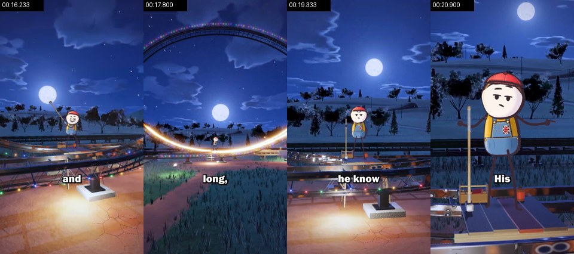

- Probabilities: live action 56%, AI-generated video 26%, 3D render 8%（fused_agent）
- ⚠️ Disputed: Tools say live action, the image review says 3D render; on the AI / live-action axis the fusion follows the tools (eval-calibrated): check the frames to see whether the review's evidence is really visible
- Material: the user's real material: live footage
- Photographic texture: noise σ=0.24, 189 colours, 11% flat blocks
- The whole file is native 30fps and photographic shots carry no 24fps-source duplicate frames (98% of the duration): typical of straight-from-phone footage, generators mostly output 24fps
- Temporal noise 1.35, 30% of pixels unchanged frame to frame: sensor noise is present, consistent with live action
- [Codex-visual-review review] Agent inspected all ten tool shot sheets, a whole-video 254-frame sample sequence at approximately 0.25-second intervals, and selected native-resolution details.
- [Codex-visual-review review] Stable rail/support topology, fixed scene landmarks and coherent parallax across moving camera views support a rendered 3D world; faces and clothing are deliberately flat illustrated characters.
- [Codex-visual-review review] No creator source project was supplied: the exact engine, asset provenance, rigging software and whether AI assisted authoring cannot be proven from the encoded clip. Do not infer live action merely from pixel statistics.
- Picture: Night hammering: an exaggerated body/arm swing meets the lower rail with sparks and a bright golden sweep. The track bottom visibly changes curvature while the camera retreats enough to show the full curve. Camera returns to worker; expression changes and a small shrug answers the narrative question. Real geometry/silhouette change is part of the explanation, not just a new camera angle.
- Camera / lighting: Varies within the detected group; see temporal breakdown; Deliberate action-oriented virtual camera, including low views and POV where described; Virtual 3D camera inferred from stable perspective/parallax; outdoor soft light (overcast / open shade); key light frame left, three-quarter front; lighting ratio about 1.4:1 (0.5 stops); medium-soft
- Text track (subtitle/bottom): and / long, / he know / His
- Remake: Source is live action: reshoot per the shooting plan (shot size / camera setup / lighting); only fall back to AI image-to-video (first frame as reference) when a shoot is not possible; real material the user must supply: live footage (whole frame)
  - First-frame image prompt: Original detailed stylized 3D environment with physically coherent materials, support structures and layered depth, expressive flat illustrated cast with costume-specific seams and accessories. Preserve readable action and the actual local framing.
  - Video prompt: Night hammering: an exaggerated body/arm swing meets the lower rail with sparks and a bright golden sweep. The track bottom visibly changes curvature while the camera retreats enough to show the full curve. Camera returns to worker; expression changes and a small shrug answers the narrative question. Real geometry/silhouette change is part of the explanation, not just a new camera angle. For an original adaptation, author the required geometry and physical acting in Blender/Three.js; stage anticipation, contact, follow-through and reaction. This is a code/3D reconstruction brief, not permission for image/video generation.

</details>

<details><summary>#5 00:21.000–00:22.200 · AI-generated video + code / editor overlays (subtitles)</summary>

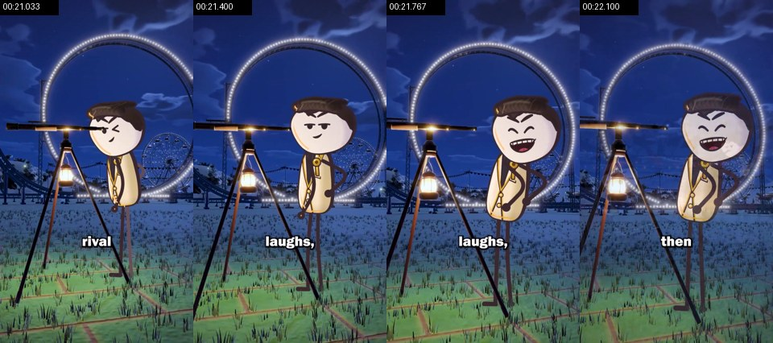

- Probabilities: AI-generated video 54%, live action 22%, 3D render 13%（fused_agent）
- ⚠️ To confirm: AI or live action, to confirm: only a sharpness rhythm, no duplicate frames (re-encodes leave it too) and no AIGC label, needs an image reader
- Material: AI-generated
- Photographic texture: noise σ=0.40, 224 colours, 14% flat blocks
- Per-frame sharpness oscillates periodically (period 2 frames, correlation 0.62) with no duplicate frames: frame interpolation / rate conversion, or just the rhythm of a re-encode (transcodes whose platform tags were stripped show it too); not enough on its own to call AI
- [Codex-visual-review review] Agent inspected all ten tool shot sheets, a whole-video 254-frame sample sequence at approximately 0.25-second intervals, and selected native-resolution details.
- [Codex-visual-review review] Stable rail/support topology, fixed scene landmarks and coherent parallax across moving camera views support a rendered 3D world; faces and clothing are deliberately flat illustrated characters.
- [Codex-visual-review review] No creator source project was supplied: the exact engine, asset provenance, rigging software and whether AI assisted authoring cannot be proven from the encoded clip. Do not infer live action merely from pixel statistics.
- Picture: Rival observes through a long telescope on tripod, turns toward the viewer and laughs with head and torso tilt. Warm hanging lantern makes a pool of light on grass; the loop and wheel remain behind him in blue night light. A short character reaction bridges the engineering action and sabotage.
- Camera / lighting: medium close-up; Deliberate action-oriented virtual camera, including low views and POV where described; Virtual 3D camera inferred from stable perspective/parallax; outdoor soft light (overcast / open shade); key light frontal (from the camera side; both sides of the subject about equally bright); lighting ratio about 1.1:1 (0.2 stops); soft light (almost no lit / shadow edge)
- Text track (subtitle/bottom): rival / laughs, / then
- Remake: Source is AI-generated: use the shot's first and last frames for first/last-frame generation to closely match composition and motion; to change the subject, edit the first frame with an image model first
  - First-frame image prompt: Original detailed stylized 3D environment with physically coherent materials, support structures and layered depth, expressive flat illustrated cast with costume-specific seams and accessories. Preserve readable action and the actual local framing.
  - Video prompt: Rival observes through a long telescope on tripod, turns toward the viewer and laughs with head and torso tilt. Warm hanging lantern makes a pool of light on grass; the loop and wheel remain behind him in blue night light. A short character reaction bridges the engineering action and sabotage. For an original adaptation, author the required geometry and physical acting in Blender/Three.js; stage anticipation, contact, follow-through and reaction. This is a code/3D reconstruction brief, not permission for image/video generation.

</details>

<details><summary>#6 00:22.200–00:31.633 · live action + code / editor overlays (subtitles, text labels); brings in real material (live footage)</summary>

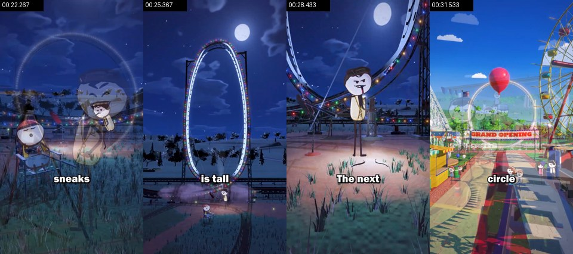

- Probabilities: live action 50%, AI-generated video 25%, 3D render 13%（fused_agent）
- ⚠️ Disputed: Tools say live action, the image review says 3D render; on the AI / live-action axis the fusion follows the tools (eval-calibrated): check the frames to see whether the review's evidence is really visible
- Material: the user's real material: live footage
- Photographic texture: noise σ=0.25, 159 colours, 15% flat blocks
- The whole file is native 30fps and photographic shots carry no 24fps-source duplicate frames (98% of the duration): typical of straight-from-phone footage, generators mostly output 24fps
- Temporal noise 1.17, 33% of pixels unchanged frame to frame: sensor noise is present, consistent with live action
- [Codex-visual-review review] Agent inspected all ten tool shot sheets, a whole-video 254-frame sample sequence at approximately 0.25-second intervals, and selected native-resolution details.
- [Codex-visual-review review] Stable rail/support topology, fixed scene landmarks and coherent parallax across moving camera views support a rendered 3D world; faces and clothing are deliberately flat illustrated characters.
- [Codex-visual-review review] No creator source project was supplied: the exact engine, asset provenance, rigging software and whether AI assisted authoring cannot be proven from the encoded clip. Do not infer live action merely from pixel statistics.
- [Codex-visual-review review] This shot looks like several cuts merged; suggest splitting at 00:28.600 (3D render→3D render): Approximate visually reviewed scene transitions/dissolve centers; detector merged these. Continuous camera moves inside a scene are described as beats, not additional cuts.
- Picture: At night the sleeping worker remains in a chair while the rival operates cables/turning motion and squeezes the loop into a tall narrow shape. Camera moves out/up to expose the changing whole silhouette and back toward the rival breaking a twig as a visual metaphor. Around 28.6s dissolve to a bright daytime opening: father and child with balloon, queue, booths, flags, wheel, confetti and red carpet. Camera travels past them toward the rival park. Night and morning are different story beats merged by the detector.
- Camera / lighting: Varies within the detected group; see temporal breakdown; Deliberate action-oriented virtual camera, including low views and POV where described; Virtual 3D camera inferred from stable perspective/parallax; outdoor soft light (overcast / open shade); key light frontal (from the camera side; both sides of the subject about equally bright); lighting ratio about 1.3:1 (0.4 stops); medium-soft
- Text track (subtitle/bottom): sneaks / is tall / The next / circle
- Text track (text/middle): GRAND OPENING
- Remake: Source is live action: reshoot per the shooting plan (shot size / camera setup / lighting); only fall back to AI image-to-video (first frame as reference) when a shoot is not possible; real material the user must supply: live footage (whole frame)
  - First-frame image prompt: Original detailed stylized 3D environment with physically coherent materials, support structures and layered depth, expressive flat illustrated cast with costume-specific seams and accessories. Preserve readable action and the actual local framing.
  - Video prompt: At night the sleeping worker remains in a chair while the rival operates cables/turning motion and squeezes the loop into a tall narrow shape. Camera moves out/up to expose the changing whole silhouette and back toward the rival breaking a twig as a visual metaphor. Around 28.6s dissolve to a bright daytime opening: father and child with balloon, queue, booths, flags, wheel, confetti and red carpet. Camera travels past them toward the rival park. Night and morning are different story beats merged by the detector. For an original adaptation, author the required geometry and physical acting in Blender/Three.js; stage anticipation, contact, follow-through and reaction. This is a code/3D reconstruction brief, not permission for image/video generation.

</details>

<details><summary>#7 00:31.633–00:34.067 · live action + code / editor overlays (subtitles, text labels); brings in real material (live footage)</summary>

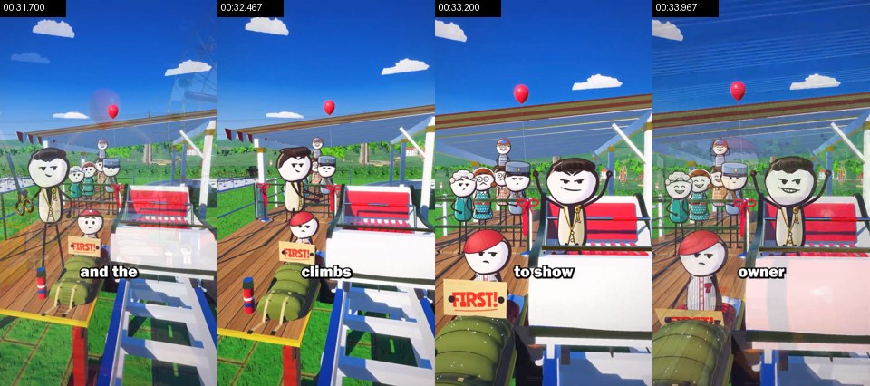

- Probabilities: live action 46%, AI-generated video 33%, 3D render 11%（fused_agent）
- ⚠️ Disputed: Tools say live action, the image review says 3D render; on the AI / live-action axis the fusion follows the tools (eval-calibrated): check the frames to see whether the review's evidence is really visible
- Material: the user's real material: live footage
- Photographic texture: noise σ=0.23, 523 colours, 13% flat blocks
- The whole file is native 30fps and photographic shots carry no 24fps-source duplicate frames (98% of the duration): typical of straight-from-phone footage, generators mostly output 24fps
- [Codex-visual-review review] Agent inspected all ten tool shot sheets, a whole-video 254-frame sample sequence at approximately 0.25-second intervals, and selected native-resolution details.
- [Codex-visual-review review] Stable rail/support topology, fixed scene landmarks and coherent parallax across moving camera views support a rendered 3D world; faces and clothing are deliberately flat illustrated characters.
- [Codex-visual-review review] No creator source project was supplied: the exact engine, asset provenance, rigging software and whether AI assisted authoring cannot be proven from the encoded clip. Do not infer live action merely from pixel statistics.
- Picture: At the rival station a queue of distinct flat illustrated citizens watches; rival steps/climbs into the front cart and smirks. The first-customer character, red seats, rope barriers, striped posts, canopy, sleepers and carriage framework provide concrete scale. Crowd expressions/gestures change in support of the main action.
- Camera / lighting: Varies within the detected group; see temporal breakdown; Deliberate action-oriented virtual camera, including low views and POV where described; Virtual 3D camera inferred from stable perspective/parallax; outdoor direct sun (hard light); key light frontal (from the camera side; both sides of the subject about equally bright); lighting ratio about 1.3:1 (0.3 stops); hard light (sharp shadow edge)
- Text track (subtitle/bottom): and the / climbs / to show / owner
- Text track (text/bottom): FIRST!
- Text track (text/middle): FIRST!
- Text track (text/middle): oto
- Remake: Source is live action: reshoot per the shooting plan (shot size / camera setup / lighting); only fall back to AI image-to-video (first frame as reference) when a shoot is not possible; real material the user must supply: live footage (whole frame)
  - First-frame image prompt: Original detailed stylized 3D environment with physically coherent materials, support structures and layered depth, expressive flat illustrated cast with costume-specific seams and accessories. Preserve readable action and the actual local framing.
  - Video prompt: At the rival station a queue of distinct flat illustrated citizens watches; rival steps/climbs into the front cart and smirks. The first-customer character, red seats, rope barriers, striped posts, canopy, sleepers and carriage framework provide concrete scale. Crowd expressions/gestures change in support of the main action. For an original adaptation, author the required geometry and physical acting in Blender/Three.js; stage anticipation, contact, follow-through and reaction. This is a code/3D reconstruction brief, not permission for image/video generation.

</details>

<details><summary>#8 00:34.067–00:44.300 · live action + code / editor overlays (subtitles); brings in real material (live footage)</summary>

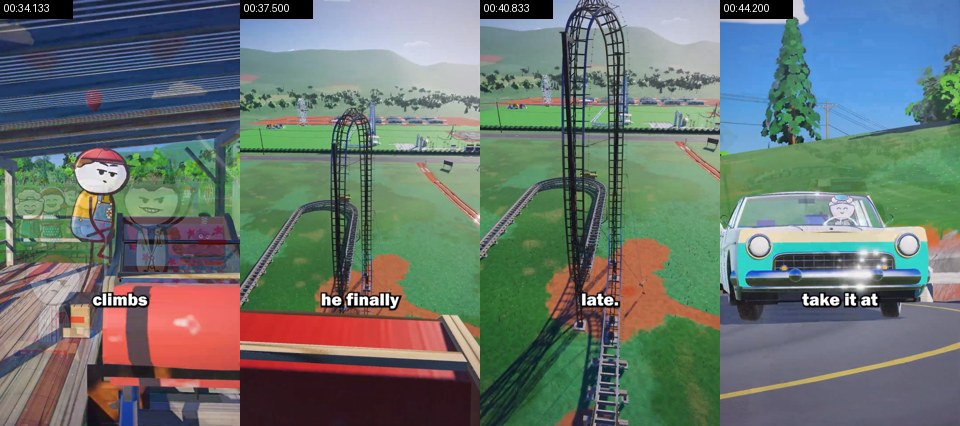

- Probabilities: live action 56%, AI-generated video 25%, 3D render 9%（fused_agent）
- ⚠️ Disputed: Tools say live action, the image review says 3D render; on the AI / live-action axis the fusion follows the tools (eval-calibrated): check the frames to see whether the review's evidence is really visible
- Material: the user's real material: live footage
- Photographic texture: noise σ=0.22, 247 colours, 10% flat blocks
- The whole file is native 30fps and photographic shots carry no 24fps-source duplicate frames (98% of the duration): typical of straight-from-phone footage, generators mostly output 24fps
- Temporal noise 1.60, 21% of pixels unchanged frame to frame: sensor noise is present, consistent with live action
- [Codex-visual-review review] Agent inspected all ten tool shot sheets, a whole-video 254-frame sample sequence at approximately 0.25-second intervals, and selected native-resolution details.
- [Codex-visual-review review] Stable rail/support topology, fixed scene landmarks and coherent parallax across moving camera views support a rendered 3D world; faces and clothing are deliberately flat illustrated characters.
- [Codex-visual-review review] No creator source project was supplied: the exact engine, asset provenance, rigging software and whether AI assisted authoring cannot be proven from the encoded clip. Do not infer live action merely from pixel statistics.
- [Codex-visual-review review] This shot looks like several cuts merged; suggest splitting at 00:41.400 (3D render→3D render): Approximate visually reviewed scene transitions/dissolve centers; detector merged these. Continuous camera moves inside a scene are described as beats, not additional cuts.
- Picture: Owner boards his cart, the camera rides/orbits with its climb, then hands the viewer a forward cart POV that progressively reveals the modified tall narrow loop and drop. Around 41.4s dissolve to a road analogy: a vintage turquoise car takes a tight hairpin slowly, with a visible driver and detailed chrome/paint/tires/glass/guardrail/road surface. This road insert is a separate explanatory scene inside one detected group.
- Camera / lighting: Varies within the detected group; see temporal breakdown; Deliberate action-oriented virtual camera, including low views and POV where described; Virtual 3D camera inferred from stable perspective/parallax; outdoor soft light (overcast / open shade); key light frame right, three-quarter front; lighting ratio about 1.5:1 (0.6 stops); soft light (wide lit-to-shadow ramp)
- Text track (subtitle/bottom): climbs / he finally / late. / take it at
- Remake: Source is live action: reshoot per the shooting plan (shot size / camera setup / lighting); only fall back to AI image-to-video (first frame as reference) when a shoot is not possible; real material the user must supply: live footage (whole frame)
  - First-frame image prompt: Original detailed stylized 3D environment with physically coherent materials, support structures and layered depth, expressive flat illustrated cast with costume-specific seams and accessories. Preserve readable action and the actual local framing.
  - Video prompt: Owner boards his cart, the camera rides/orbits with its climb, then hands the viewer a forward cart POV that progressively reveals the modified tall narrow loop and drop. Around 41.4s dissolve to a road analogy: a vintage turquoise car takes a tight hairpin slowly, with a visible driver and detailed chrome/paint/tires/glass/guardrail/road surface. This road insert is a separate explanatory scene inside one detected group. For an original adaptation, author the required geometry and physical acting in Blender/Three.js; stage anticipation, contact, follow-through and reaction. This is a code/3D reconstruction brief, not permission for image/video generation.

</details>

<details><summary>#9 00:44.300–00:45.000 · live action + code / editor overlays (subtitles); brings in real material (live footage)</summary>

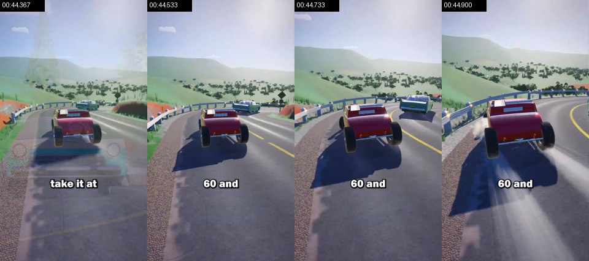

- Probabilities: live action 56%, AI-generated video 27%, 3D render 7%（fused_agent）
- ⚠️ Disputed: Tools say live action, the image review says 3D render; on the AI / live-action axis the fusion follows the tools (eval-calibrated): check the frames to see whether the review's evidence is really visible
- Material: the user's real material: live footage
- Photographic texture: noise σ=0.13, 148 colours, 10% flat blocks
- The whole file is native 30fps and photographic shots carry no 24fps-source duplicate frames (98% of the duration): typical of straight-from-phone footage, generators mostly output 24fps
- Temporal noise 1.27, 31% of pixels unchanged frame to frame: sensor noise is present, consistent with live action
- [Codex-visual-review review] Agent inspected all ten tool shot sheets, a whole-video 254-frame sample sequence at approximately 0.25-second intervals, and selected native-resolution details.
- [Codex-visual-review review] Stable rail/support topology, fixed scene landmarks and coherent parallax across moving camera views support a rendered 3D world; faces and clothing are deliberately flat illustrated characters.
- [Codex-visual-review review] No creator source project was supplied: the exact engine, asset provenance, rigging software and whether AI assisted authoring cannot be proven from the encoded clip. Do not infer live action merely from pixel statistics.
- Picture: At about 44.3s dissolve to an elevated rear chase view of a red open car and other traffic approaching the same road hairpin faster. Vehicle yaw, outward drift and the first skid begin; the animation continues into detector group 10. Dust/smoke here is a visible effect; exact audio identity remains unverified.
- Camera / lighting: Varies within the detected group; see temporal breakdown; Deliberate action-oriented virtual camera, including low views and POV where described; Virtual 3D camera inferred from stable perspective/parallax; outdoor backlight (sun or bright sky behind the subject); key light frontal (from the camera side; both sides of the subject about equally bright); lighting ratio about 1.1:1 (0.1 stops); soft light (almost no lit / shadow edge)
- Text track (subtitle/bottom): take it at / 60 and
- Remake: Source is live action: reshoot per the shooting plan (shot size / camera setup / lighting); only fall back to AI image-to-video (first frame as reference) when a shoot is not possible; real material the user must supply: live footage (whole frame)
  - First-frame image prompt: Original detailed stylized 3D environment with physically coherent materials, support structures and layered depth, expressive flat illustrated cast with costume-specific seams and accessories. Preserve readable action and the actual local framing.
  - Video prompt: At about 44.3s dissolve to an elevated rear chase view of a red open car and other traffic approaching the same road hairpin faster. Vehicle yaw, outward drift and the first skid begin; the animation continues into detector group 10. Dust/smoke here is a visible effect; exact audio identity remains unverified. For an original adaptation, author the required geometry and physical acting in Blender/Three.js; stage anticipation, contact, follow-through and reaction. This is a code/3D reconstruction brief, not permission for image/video generation.

</details>

<details><summary>#10 00:45.000–01:03.167 · live action + code / editor overlays (subtitles, static sticker); brings in real material (live footage)</summary>

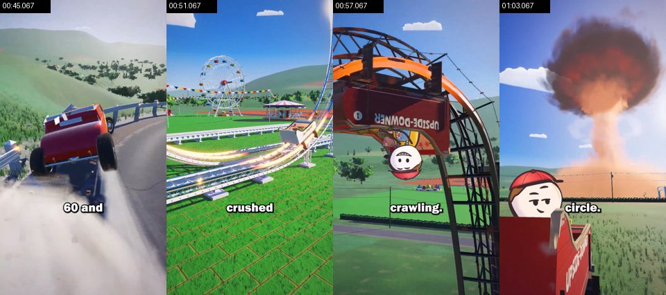

- Probabilities: live action 57%, AI-generated video 27%, 3D render 7%（fused_agent）
- ⚠️ Disputed: Tools say live action, the image review says 3D render; on the AI / live-action axis the fusion follows the tools (eval-calibrated): check the frames to see whether the review's evidence is really visible
- Material: the user's real material: live footage
- Photographic texture: noise σ=0.19, 261 colours, 10% flat blocks
- The whole file is native 30fps and photographic shots carry no 24fps-source duplicate frames (98% of the duration): typical of straight-from-phone footage, generators mostly output 24fps
- Temporal noise 1.32, 28% of pixels unchanged frame to frame: sensor noise is present, consistent with live action
- [Codex-visual-review review] Agent inspected all ten tool shot sheets, a whole-video 254-frame sample sequence at approximately 0.25-second intervals, and selected native-resolution details.
- [Codex-visual-review review] Stable rail/support topology, fixed scene landmarks and coherent parallax across moving camera views support a rendered 3D world; faces and clothing are deliberately flat illustrated characters.
- [Codex-visual-review review] No creator source project was supplied: the exact engine, asset provenance, rigging software and whether AI assisted authoring cannot be proven from the encoded clip. Do not infer live action merely from pixel statistics.
- [Codex-visual-review review] This shot looks like several cuts merged; suggest splitting at 00:46.250, 00:52.200, 00:59.600 (3D render→3D render→3D render→3D render): Approximate visually reviewed scene transitions/dissolve centers; detector merged these. Continuous camera moves inside a scene are described as beats, not additional cuts.
- Picture: Continuation of the fast road car: it strikes/breaks the barrier and tumbles, with flying debris and dust. Around 46.25s dissolve back to a white circular coaster, camera tracks toward its tight bottom while a golden moving highlight demonstrates the sharp bend and a cart crosses it. Around 52.2s return to the modified tall loop: owner cart rises and slows toward its tighter top; close upside-down face changes from shock to relief while the camera tracks/orbits with it. At about 59.6s camera returns to the receding park and the rival ride produces a huge comic explosion; the owner in the foreground looks back and smirks. This is several explanatory and payoff beats, not one uninterrupted live-action take.
- Camera / lighting: Varies within the detected group; see temporal breakdown; Deliberate action-oriented virtual camera, including low views and POV where described; Virtual 3D camera inferred from stable perspective/parallax; outdoor soft light (overcast / open shade); key light frontal (from the camera side; both sides of the subject about equally bright); lighting ratio about 1.0:1 (0.1 stops); soft light (almost no lit / shadow edge)
- Text track (subtitle/bottom): 60 and / crushed / crawling. / circle.
- Text track (text/middle): UPSIDE-DOWNER
- Remake: Source is live action: reshoot per the shooting plan (shot size / camera setup / lighting); only fall back to AI image-to-video (first frame as reference) when a shoot is not possible; real material the user must supply: live footage (whole frame)
  - First-frame image prompt: Original detailed stylized 3D environment with physically coherent materials, support structures and layered depth, expressive flat illustrated cast with costume-specific seams and accessories. Preserve readable action and the actual local framing.
  - Video prompt: Continuation of the fast road car: it strikes/breaks the barrier and tumbles, with flying debris and dust. Around 46.25s dissolve back to a white circular coaster, camera tracks toward its tight bottom while a golden moving highlight demonstrates the sharp bend and a cart crosses it. Around 52.2s return to the modified tall loop: owner cart rises and slows toward its tighter top; close upside-down face changes from shock to relief while the camera tracks/orbits with it. At about 59.6s camera returns to the receding park and the rival ride produces a huge comic explosion; the owner in the foreground looks back and smirks. This is several explanatory and payoff beats, not one uninterrupted live-action take. For an original adaptation, author the required geometry and physical acting in Blender/Three.js; stage anticipation, contact, follow-through and reaction. This is a code/3D reconstruction brief, not permission for image/video generation.

</details>

### Metadata clues

- Encoder: `Lavf59.27.100`

### Notes

- Deterministic forensics is reliable on motion, whole-frame pan/zoom, rendered texture and 24→30 fps conversion; telling live action from AI from 3D relies on the VLM and human review.
- Platform transcoding usually strips metadata; missing metadata proves nothing.
- The full data is in `breakdown.json`; agents read the compact view with `rea-video summary`.
